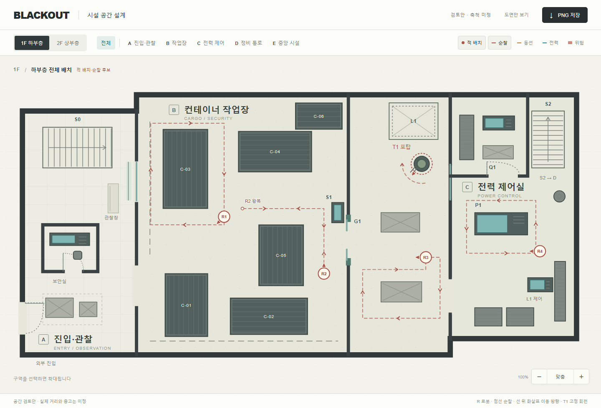
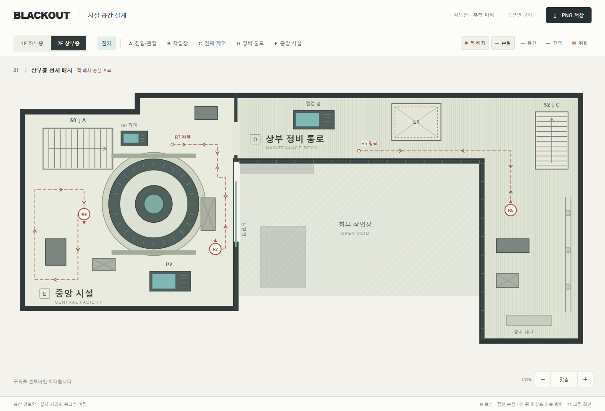

# BLACKOUT 공간 설계도

[blackout-plan.html](blackout-plan.html)이 수정 기준이 되는 원본이다. 두 기기에서 이 저장소의 같은 파일을 사용한다.

저장소를 내려받은 뒤 HTML 파일을 브라우저로 열면 된다. 별도 설치나 서버 실행은 필요 없다. GitHub의 HTML 파일 페이지에서는 소스 코드가 표시된다.

- 1층: A 진입·관찰, B 컨테이너 작업장, C 전력 제어실
- 2층: D 상부 정비 통로, E 중앙 시설
- 구역 선택·확대·이동, 적 배치·순찰·동선·전력·위험 표시 전환, PNG 저장 지원
- 로봇 7기와 포탑 1기의 배치 및 순찰 후보 포함

축척·실제 거리·층고와 전투 수치는 미정이다. 이 도면은 검토안이며, [Unity 장면](../BlackOut/Assets/BLACKOUT/Scenes/Levels/CargoStation.unity)의 현재 구현 상태와 별도로 확인해야 한다.

## 1층 미리보기

## 2층 미리보기

