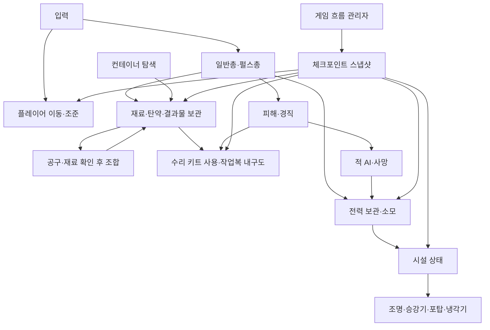

# BLACKOUT — 게임 기획서 / PRD

> 문서 상태: 기존 전력 중심안 기반 개정안 · 신규 자원·조합 수치 검토 중
>
> 대상 버전: Unity 6000.3.22f1 · URP · Windows PC  
> 목표 플레이 시간: 10~15분
>
> 2026-11-11 개정: 플레이어 HP를 작업복 내구도로 표현하고, 일반총·펄스총 2종과 컨테이너 재료 탐색·조합을 추가한다. 아래 규칙은 기획이며 구현 완료를 뜻하지 않는다.

## 1. 한 문장

정전된 화물역에서 **전력 세 칸을 적과 시설 사이로 옮기고, 컨테이너에서 찾은 재료로 작업복을 수리하거나 총알을 제작하며** 길을 여는 3인칭 액션 게임이다.

## 2. 프로젝트 의의

재미있는 아이디어를 많이 붙이는 것보다 3D 게임 클라이언트의 기본 시스템을 끝까지 연결하는 것이 우선이다.

- Transform과 벡터를 사용하는 이동·회전
- 3인칭 카메라, 조준, 발사체와 충돌
- NavMesh와 상태 기반 적 AI
- Animator를 이용한 이동·공격·피격·사망
- 작업복 내구도, 전력·탄약·조합 재료, 상호작용, UI 피드백
- 게임 상태, 체크포인트, 실패 후 복원
- 조명·파티클·3D 사운드와 Windows 빌드

에셋은 외형을 제공하지만 위 동작과 규칙은 직접 구현한다.

## 3. 이야기와 세계

도시 전체가 정전된 밤, 자동화 화물역의 예비 전력이 관제탑에 고립됐다. 플레이어는 구조대나 군인이 아니라 시설을 실제로 다룰 수 있는 **도시 시설 관리 작업자**다. 휴대 장비에는 전력 세 칸만 저장할 수 있다.

플레이어가 피해를 버티는 정도는 **보호 작업복의 내구도**로 표현한다. 정비 자재와 보안 물자를 취급하는 컨테이너에서 부품을 찾아 범용 공구로 조합하고, 작업복 보수 또는 일반총 탄약 확보에 사용한다.

정전 직전의 보안 명령이 끝나지 않아 경비 로봇은 사람을 침입자로 판단한다. 시설에 전력을 넣으면 조명과 승강기가 돌아오지만 같은 회로의 포탑과 보안 장치도 깨어난다. 따라서 “전력을 복구하면 무조건 좋아진다”가 아니라, 무엇을 켜고 무엇을 다시 끌지 결정해야 한다.

목표는 화물 승강기를 복구해 관제탑으로 올라가고, 오작동하는 경비 로봇을 정지시켜 예비 전력을 도시 송전망으로 돌리는 것이다.

## 4. 플레이어 경험 목표

1. 어두운 공간을 보고 “전력이 필요하다”고 이해한다.
2. 적을 쓰러뜨려 전력을 얻는다.
3. 전력을 시설에 주입해 공간이 실제로 바뀌는 것을 본다.
4. 켜진 시설이 새 위험도 만들었다는 사실을 체험한다.
5. 전력을 회수해 다시 상황을 바꾸고 자신만의 경로를 만든다.
6. 같은 규칙을 보스전에서 더 빠르고 압박감 있게 사용한다.
7. 컨테이너의 표식과 적재물을 보고 필요한 조합 재료를 찾는다.
8. 공통 재료를 작업복 수리와 총알 제작 중 어디에 쓸지 선택한다.
9. 전력이 부족하거나 시설에 전력을 남겨야 할 때 일반총으로 전투를 이어간다.

## 5. 핵심 규칙

### 5.1 전력

- 플레이어 보유 한도는 3칸이다.
- 일반 로봇은 사망 후 잔류 전력 1칸을 남긴다.
- 가까이 가서 0.7초 동안 흡수하면 한 칸을 얻는다. 피격되면 흡수가 취소된다.
- 시설은 1~2칸을 요구하며, 작동 중인 시설에서는 전력을 다시 회수할 수 있다.
- 회수 즉시 시설은 정전 상태로 돌아간다. 움직이는 승강기에서는 회수할 수 없다.
- 보유량이 꽉 찼으면 흡수할 수 없고 짧은 문구와 소리로 이유를 알려준다.
- 펄스총 공격과 시설 작동에 같은 보유 전력을 사용한다. 공격에 쓴 전력은 소모되며, 시설에 주입한 전력은 위 회수 규칙을 따른다.
- 미정: 기본·충전 펄스별 전력 소모량, 1칸 안의 세부 소모 단위, 전투 소모를 반영한 수급량과 필수 시설 진행 불가 방지 규칙.

### 5.2 일반총과 펄스총

무기는 **일반총과 펄스총 두 자루**를 사용한다.

| 무기·공격 | 조작과 결과 | 사용하는 자원 |
|---|---|---|
| 일반총 | 일상적인 전투에 사용. 구체적인 총기와 발사 방식은 미정 | 조합으로 제작하는 일반총 총알. 전력은 사용하지 않음 |
| 펄스총 — 기본 사격 | 짧게 눌러 빠른 기본 펄스 발사, 일반 피해 | 보유 전력. 공격별 소모량 미정 |
| 펄스총 — 충전 사격 | 길게 눌렀다 놓으면 느리고 큰 충전 펄스 발사, 적 경직·약점 피해 | 보유 전력. 공격별 소모량 미정 |

- 잔류 전력에 상호작용하면 전력을 흡수하고, 시설 소켓에서는 한 칸을 주입하거나 회수한다.
- 펄스총용 총알은 제작하지 않는다. 일반총은 전력이 부족하거나 시설용 전력을 아끼려는 상황에서도 사용할 수 있다.
- 미정: 일반총의 종류·발사 방식·장탄량·재장전, 무기 교체 조작, 무기별 피해량과 발사 간격.

### 5.3 전력으로 변하는 공간

| 시설 | 정전 | 전력 주입 | 전력 회수 |
|---|---|---|---|
| 작업등 회로 | 어둡고 적 식별이 어려움 | 전투 공간과 약점이 보임 | 다시 어두워져 은폐 가능 |
| 화물 승강기 | 위층 접근 불가 | 이동 가능, 운행 중 소음으로 적 경계 | 정차 후 회수하면 아래에 고정 |
| 보안 회로 | 포탑 정지 | 문이 열리지만 포탑도 활성화 | 문과 포탑 모두 다시 정지 |
| 보스 냉각기 | 보스 약점이 닫힘 | 냉각이 작동해 약점 노출 | 약점이 닫히고 전력을 되찾음 |

메뉴에서 선택만 하는 전력 배분은 금지한다. 플레이어가 소켓까지 이동하고, 위험을 감수해 직접 주입·회수하며, 공간·빛·소리·적 행동이 함께 바뀌어야 한다.

### 5.4 맵 기능 — 구현 예정

- 단축키로 지도를 열고 닫으며, 현재 위치와 주요 목표 위치를 표시한다.
- 방문한 구역과 미방문 구역을 구분한다.
- 미정: 지도 단축키, 미니맵 제공 여부, 탐색 기록 저장 여부.

### 5.5 작업복 내구도와 수리

- 플레이어 HP의 화면 명칭과 설정은 **작업복 내구도**로 통일한다. 적과 보스의 체력은 별도다.
- 피격되면 작업복 내구도가 감소하고, 0이 되면 진행에 실패해 체크포인트로 복원한다.
- 조합으로 만든 **작업복 수리 키트**를 사용해 내구도를 복구한다. 완성된 응급 키트를 일반 화물 컨테이너에서 찾는 방식 대신, 원재료 탐색과 조합을 기본으로 한다.
- 미정: 최대 내구도, 수리 키트의 내구도 복구량·사용 시간·전투 중 사용 가능 여부, 수리 키트 사용 시 소모 규칙, 내구도가 가득 찼을 때의 사용 처리.

### 5.6 컨테이너 재료와 아이템 조합

컨테이너는 엄폐와 이동 경로를 만드는 동시에 정비 자재와 보안 물자의 탐색 장소가 된다. 외부 표식과 적재물로 어떤 재료가 있을지 짐작할 수 있게 한다.

| 재료·도구 | 화물역에 있는 이유 | 사용처 |
|---|---|---|
| 금속 부품 | 시설 정비용 체결 부품·가공 부품 | 작업복 수리 키트·일반총 총알·소음 유인 장치 제작에 공통 사용 |
| 보강 소재 | 작업복·산업용 보호 장비의 교체 자재 | 작업복 수리 키트 제작 |
| 탄약 부품 | 화물역 보안 장비에 납품하는 전용 부품 | 일반총 총알 제작 |
| 배선 | 시설·장비 정비에 쓰는 교체용 배선 | 소음 유인 장치 제작 |
| 범용 공구 | 시설 관리 작업에 사용하는 도구 | 조합에 필요하며 조합할 때 소모되지 않음 |

- 정비 자재 컨테이너에는 금속 부품·보강 소재·배선, 보안 물자 컨테이너에는 탄약 부품을 배치하는 것을 기본으로 한다.
- 원재료는 여러 용도로 사용하는 물품으로 설정하고, 작업복 수리 키트·총알·소음 유인 장치는 그 재료를 조합한 결과물로 둔다.

**조합 공식 초안 — 아래 수량은 플레이 검증 전 임시 값이다.**

| 소모 재료 | 제작 결과 |
|---|---|
| 금속 부품 1개 + 보강 소재 2개 | 작업복 수리 키트 1개 |
| 금속 부품 2개 + 탄약 부품 1개 | 일반총 총알 10발 |
| 금속 부품 + 배선 (필요 수량 미정) | 소음 유인 장치 (제작 수량 미정) |

- 세 조합 모두 범용 공구를 보유해야 한다. 공구는 남고, 제작 성공 시 조합 재료만 소모된다.
- 소음 유인 장치는 소음을 발생시켜 적의 주의를 분산하는 용도로 사용한다. 투척·설치 여부, 반응하는 적 종류와 반응 우선순위, 소음 범위·지속 시간·사용 시 소모 규칙은 미정이다.
- 금속 부품을 공유하므로 작업복 수리, 총알 확보, 적의 주의를 돌리는 장치 제작 중 어디에 사용할지 선택하게 한다.
- 재료가 부족하거나 제작이 취소되면 재료를 소모하지 않고 결과물도 생성하지 않는다.
- 미정: 공구 획득 시점, 재료 발견량·배치, 소지 한도와 보관 UI, 조합 장소·제작 시간·전투 중 조합 가능 여부, 탄약 제작 수량의 최종 값, 추가 조합 공식.

## 6. 전투 대상

### 6.1 추적 로봇

- 역할: 이동·NavMesh·상태 전환을 보여주는 기본 적
- 흐름: 순찰 → 소리/시야로 발견 → 추격 → 사거리 안 공격 → 수색 → 순찰
- 공격: 명확한 0.6초 예고 후 근거리 충격 또는 짧은 펄스
- 대응: 엄폐, 거리 유지, 충전 사격 경직
- 사망: 전력 한 칸 생성

### 6.2 고정 포탑

- 역할: 전력을 넣어 생긴 새로운 위험
- 흐름: 보안 회로 정전 시 완전 정지, 통전 시 탐색 → 조준선 → 연사
- 대응: 엄폐 사이 이동, 전력 회수로 비활성화, 측면 약점 사격
- 이동 애니메이션이 없어도 회전축·총열·발광 상태로 읽혀야 한다.

### 6.3 관제탑 경비 로봇 — 보스

보스만 별도의 새로운 규칙을 사용하지 않는다. 이전에 배운 전력 주입·회수와 충전 사격을 조합한다.

**1단계**

- 보스가 느린 직선 사격과 바닥 충격을 번갈아 사용한다.
- 경기장 양쪽 작업등을 켜면 공격 예고와 등 뒤 전력 코어가 잘 보인다.
- 켠 작업등의 회로는 동시에 포탑 하나를 깨운다.

**2단계**

- 체력 50%에서 보스가 과열되고 중앙 냉각기 소켓이 열린다.
- 전력 2칸을 냉각기에 넣으면 8초 동안 코어가 노출된다.
- 노출 중 충전 사격으로 큰 피해를 준다.
- 냉각 종료 후 전력을 회수해 다음 노출을 준비한다.
- 이 순환을 두 번 성공하면 처치 가능하다.

## 7. 10~15분 레벨 흐름

| 시간 | 구간 | 플레이 결과 |
|---:|---|---|
| 0~2분 | 정문·하역장 | 이동·조준, 꺼진 승강기와 첫 소켓 발견 |
| 2~5분 | 컨테이너 통로 | 추적 로봇 전투, 첫 전력 흡수, 재료 탐색과 수리·탄약 조합 선택 |
| 5~8분 | 보안 게이트 | 전력으로 문과 포탑이 동시에 켜지는 대가 학습 |
| 8~10분 | 화물 승강기 | 전력 2칸 확보, 체크포인트 저장, 작업복 내구도·탄약·재료 정비 |
| 10~15분 | 관제탑 | 2단계 보스, 승리 후 송전 복구 |

환경은 한 장면 안에서 연결한다. 로딩이나 장면 전환 없이 실패 후 가장 가까운 체크포인트로 복원한다.

## 8. 실패와 복원

- 플레이어의 작업복 내구도가 0이면 입력·AI 전투를 잠시 멈추고 실패 이유를 표시한다.
- 최근 체크포인트의 위치, 작업복 내구도, 보유 전력, 시설 상태, 처치한 고정 조우를 복원한다.
- 복원 대상에 일반총 탄약, 조합 재료·공구·제작 결과물의 보유 상태와 컨테이너 획득 상태를 포함해, 복원으로 재료나 결과물이 중복되지 않게 한다. 구체적인 저장 자료 구조는 미정이다.
- 보스 진입 직전 체크포인트는 자동 저장한다.
- 작업복 내구도 복구는 수리 키트가 담당한다. 기존 1회 충전소의 유지 여부·전력 보급 역할·공급량은 미정이다.
- 저장 파일이나 여러 장면 영속화는 기말 범위가 아니다.

## 9. 시스템 책임 경계

한 스크립트가 모두 처리하지 않는다. 플레이어, 무기, 피해·작업복 내구도, 전력, 재료·탄약 보관, 조합, 시설, AI, 게임 흐름이 이벤트와 작은 인터페이스로 연결되어야 한다.

## 10. 완료 기준

- 처음 보는 사람이 설명 없이 정전/통전 상태를 구분한다.
- 전력 주입과 회수로 최소 두 시설의 물리적 상태가 바뀐다.
- 일반총은 제작한 총알을, 펄스총의 기본·충전 공격은 전력을 사용하며 부족한 자원으로는 발사되지 않는다.
- 컨테이너에서 얻은 재료로 수리 키트·총알·소음 유인 장치를 조합하고, 공통 재료의 사용처를 선택할 수 있다.
- 수리 키트 사용으로 작업복 내구도가 복구되며, 제작 취소·재료 부족·체크포인트 복원으로 물품이 복제되지 않는다.
- 추적 로봇과 포탑의 공격 예고·피격·사망 원인이 읽힌다.
- 사망 후 같은 장면에서 체크포인트 상태가 일관되게 복원된다.
- 보스가 2단계로 전환되고 전력 규칙을 사용해야만 약점을 공격할 수 있다.
- 시작부터 승리까지 10~15분 Windows 빌드를 오류 없이 플레이할 수 있다.
- README, 30~60초 핵심 영상, 에셋 출처표가 실제 구현과 일치한다.

## 11. 하지 않는 것

- 멀티플레이, 대화 선택지, 절차 생성
- 스킬 트리, 장비 강화
- 5개 구역 전체와 구역 간 저장
- 감시 드론, 방패 유닛, 추가 보스
- 에셋 외형을 그대로 따라 새 3D 모델을 대량 제작하는 일

## 12. 가장 위험한 세 가지

1. **에셋 결합이 늦어지는 문제:** W07 이전에 환경·주인공·적 세트를 한 테스트 장면에서 검증한다.
2. **전력 규칙이 UI 버튼처럼 느껴지는 문제:** 모든 전력 조작은 월드 소켓, 이동 위험, 즉시 보이는 공간 변화가 있어야 한다.
3. **보스만 새 게임이 되는 문제:** 보스는 일반 구간의 전력·충전 사격·공격 예고만 재조합한다.

기말 이후 후보는 전력으로 지름길을 잠깐 여는 우회로(13장에 상세), 적이 시설 전력을 훔치는 역상호작용, 둘 중 하나만 유지할 수 있는 양자택일 시설 순이다. 기말 필수 범위가 끝나기 전에는 착수하지 않는다.

## 13. 스트레치 후보 상세 — 지름길 우회로

T00~T24 핵심 범위가 끝난 뒤에만 착수한다. 새 구역·새 적 종류·새 UI를 만들지 않고, 기존 전력 소켓 인터페이스(T15)와 추적 로봇 상태 전환(T17)만 재사용해 반복 구간을 줄이는 선택지를 하나 더 만든다.

### 13.1 위치와 규칙

컨테이너 통로(2~5분 구간)와 보안 게이트(5~8분 구간) 사이에 잠긴 보조 통로 셔터를 하나 둔다. 정문부터 다시 뛰지 않고 직전 구간으로 바로 돌아갈 수 있게 하는 것이 목적이다.

| 상태 | 정전 | 전력 주입(1칸) | 전력 회수 |
|---|---|---|---|
| 보조 셔터 | 잠김, 두 구간은 각자의 정규 경로로만 연결 | 셔터가 열려 두 구간이 직결됨. 열리는 소리가 셔터 양쪽 추적 로봇의 수색 반경을 동시에 깨운다 | 즉시 다시 잠김. 셔터를 통과하던 적이 있으면 반대쪽 구간에 남는다 |

- 메뉴 선택이 아니라 소켓까지 이동해 직접 주입/회수해야 하며, 즉시 보이는 물리적 변화(셔터 개폐)가 있어야 한다는 5.3의 원칙을 그대로 따른다.
- "지름길 = 공짜 길"이 되지 않도록, 열어 두는 동안 양쪽 추적 로봇이 동시에 경계 상태가 되는 대가를 반드시 유지한다.
- 사망 후 체크포인트 복원 시 셔터는 항상 잠긴 상태로 복원한다(운행 중인 승강기처럼 중간 상태를 저장하지 않는다).

### 13.2 착수 조건과 재사용 범위

- 선행: T15(시설·조명·보안 회로), T17(추적 로봇 상태 전환), T19(유한 조우) 완료 후.
- 구현량: 소켓 1개, 셔터 애니메이션/콜라이더 토글, 양쪽 추적 로봇에 "경계" 상태를 거는 트리거 — 새 스크립트 1~2개 수준으로 제한한다.
- 11장의 금지 목록(5구역 전체, 추가 적 종류 등)을 넘기지 않는지 착수 전에 다시 확인한다.
