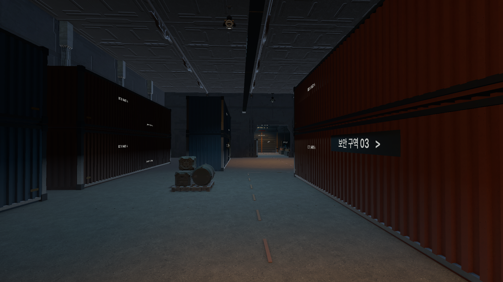
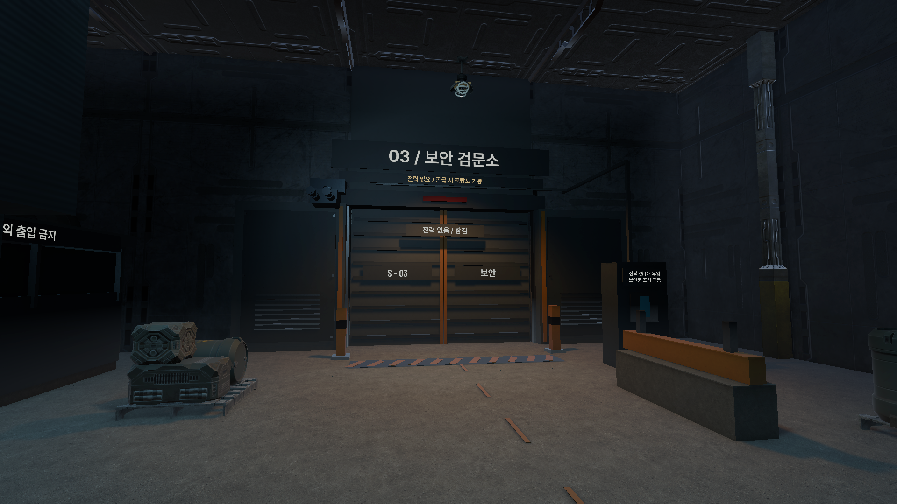
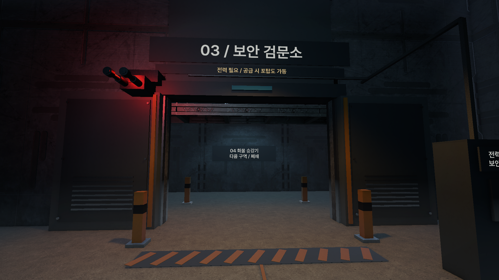

# BLACKOUT — 화물역 재질 제작·적용 기록

2026-09-30. 하역장·컨테이너 통로·보안 게이트에 서로 다른 표면을 적용했다. 물체의 배치와 충돌 범위, 한글 안내는 유지했다. 이번 작업은 재질 개선이며 조명 재설계·새 소품·게임 기능 추가는 포함하지 않는다.

## 파일 위치

- 적용 장면: `BlackOut/Assets/BLACKOUT/Scenes/Levels/CargoStation.unity`
- 재질: `BlackOut/Assets/BLACKOUT/Art/Materials/CargoStation/`
- 표면 이미지: `BlackOut/Assets/BLACKOUT/Art/Textures/CargoStation/`
- 반사 이미지: `BlackOut/Assets/BLACKOUT/Art/CargoStation/Reflections/`
- 제작 코드: `BlackOut/Assets/BLACKOUT/Scripts/Editor/BlackoutCargoMaterials.cs`
- 생성 원본·변경 전 백업: `Tools/ArtSources/CargoStation/`
- 출처와 전체 생성 프롬프트: [재질 에셋 원장](../assets/BLACKOUT_CargoMaterials_Manifest.json)

## 재질 구성

| 적용 대상 | 재질 | 표면 기준 |
|---|---|---|
| 주요 바닥 53개 | `Concrete_Dry` | 거친 콘크리트, 낮은 광택, 작은 골재 |
| 출입부·외곽 바닥 7개 | `Concrete_Damp` | 부분적으로 어둡고 매끈한 젖은 콘크리트 |
| 보호 난간·경비실 받침 | `Concrete_Barrier` | 바닥보다 진하고 거친 콘크리트 |
| 컨테이너 | `Paint_Blue`, `Paint_Oxide`, `Paint_Ochre` | 낮은 금속성의 도장, 작은 흠집 |
| 보안문·큰 외장 판 | `Paint_Gate` | 회청색 도장 철판 |
| 문 수납부·전력함·표지 받침 | `Paint_Graphite` | 어두운 회색 도장 |
| 안전 난간·차선 | `Safety_Ochre` | 절제된 황색 도장 |
| 레일·잠금장치 | `Steel_Brushed` | 도장과 구분되는 금속 반사 |
| 전력 배관 | `Steel_Galvanized` | 거친 아연도금 금속 |
| 포탑 부품 | `Steel_Gunmetal` | 어두운 금속 |
| 검은 완충 띠 등 | `Rubber_Cable` | 금속성이 없는 무광 고무 |
| 경비실 창 | `Glass_Smoked` | 매끈한 짙은 유리 표현 |

새 표면 재질 14개와 기존 키트의 재질 복사본 34개, 총 48개를 사용한다. 키트 복사본은 원래의 세부 무늬·요철·잘라내기 정보를 유지하며 색과 광택을 조절한다. 원본 키트와 `Intro.prefab`, 사용자 작업 중인 `testScene.unity`는 수정하지 않는다.

경비실 창은 내부 공간이 없는 기존 형태를 유지하므로 **불투명한 짙은 유리 표현**이다. 투명한 창과 내부 집기까지 구현한 것은 아니다.

## 표면 이미지와 반복 크기

내장 이미지 생성 도구로 콘크리트와 중립 회색 도장면의 원본을 만들었다. 프롬프트는 그림자·반사·글자가 없는 평면 표면, 낮은 대비, 반복 가능한 가장자리를 요구한다. 전체 프롬프트와 생성 식별자는 원장에 보관한다.

실제 게임에 쓰는 이미지는 1,024×1,024 크기다. 다섯 표면군마다 기본색, 작은 요철 방향, 금속성·매끈함 정보를 저장해 총 15장을 사용한다. 금속 표면 데이터와 젖음 분포는 프로젝트 코드로 작성했다. 요철은 조절 가능한 추정 표현이며 실제 재료를 측정한 스캔이 아니다.

- 기본색은 sRGB, 요철과 금속·광택 데이터는 선형 색 공간.
- 금속·광택 이미지의 R은 금속성, A는 매끈함. 설치된 URP Lit 소스의 채널 규칙을 확인했다.
- 멀리서 무늬가 떨리지 않도록 작은 크기용 이미지도 생성하는 mipmap, Trilinear 필터, 반복 표시, 비등방성 8 적용.
- 게임 실행 중 이미지의 CPU 읽기·쓰기는 꺼 둔다.
- 바닥 기본 반복은 3m. 길쭉한 상자에서도 무늬가 늘어나지 않도록, 표면 좌표만 수정한 프로젝트 전용 메시 복사본 83개를 공유한다. 모양·꼭짓점 수·충돌체는 유지한다.
- 가장자리 24픽셀을 보정하고 [3×3 콘크리트 반복](../images/production/cargo-materials/tile-3x3-Concrete.png), [3×3 도장면 반복](../images/production/cargo-materials/tile-3x3-CoatedSteel.png)을 검사했다.

## 화면 검수와 수정

1. 첫 적용에서 벽과 천장이 지나치게 어두워져 복사 재질의 기본색을 올렸다.
2. 게이트 위 큰 판에 금속 반사가 넓게 생겨, 해당 판과 경비실 큰 외장을 도장 철판으로 변경했다.
3. 컨테이너 세 색의 밝기를 조정해 어두운 곳에서도 차이가 남도록 했다.
4. 하역장·통로·게이트에 주변 반사를 미리 저장하는 장치 3개를 배치했다. 실시간 조명은 추가하지 않았다.
5. 재열기 검사에서 반사 연결이 사라져, 직접 저장한 반사 이미지를 `Custom` 방식으로 연결하도록 수정했다. [Unity 공식 API](https://docs.unity3d.com/6000.3/Documentation/ScriptReference/ReflectionProbe-customBakedTexture.html)

## 검증과 다시 실행하기

- [재질·이미지·반사 연결 검사](../images/production/cargo-materials/validation.json)
- [모양·충돌체·표지 보존 검사](../images/production/cargo-materials/geometry-preserved.json)
- [통행 경로와 문 상태 검사](../images/production/cargo-station/validation.json)
- [한글 안내 42개 검사](../images/production/cargo-station/korean-sign-validation.json)
- [실행 상태 검사](../images/production/cargo-materials/playmode-validation.json), [실행 화면](../images/production/cargo-materials/07-playmode.png)

최종 검사에서 재질·표면 이미지·반사 참조 오류는 0개였다. 저장 후 다시 열기와 Play Mode에서 반사 이미지 3개가 유지되고, 누락 재질과 지원되지 않는 셰이더는 0개였다. 최종 실행 시 Unity 콘솔 오류·경고도 0개였으며, 주요 통행 경로·문 닫힘/열림·전력함 및 회복 공간 접근 검사와 한글 표지 42개 검사가 통과했다.

Unity에서 장면을 열면 이미 적용되어 있다. 일반 확인에는 생성기를 실행할 필요가 없다.

재생성이 필요한 경우 `BLACKOUT > Cargo Station` 메뉴에서 `7 Create and apply surface materials` → `8 Bake material reflections` → `9 Capture material review` 순서로 실행한다. **7번은 이번 작업이 만든 재질 설정을 다시 쓰므로, 이후 사람이 조절한 값이 있으면 먼저 보관해야 한다.** 반사 이미지는 문이 닫힌 기준 상태이며, 전력 상태마다 실시간으로 다시 만드는 반사는 아니다.

이 작업은 1920×1080 화면과 참조·통행 검증 범위다. 실제 캐릭터 카메라, 전투 가림, 목표 PC의 60fps와 최종 빌드 성능을 검증한 것은 아니다.
