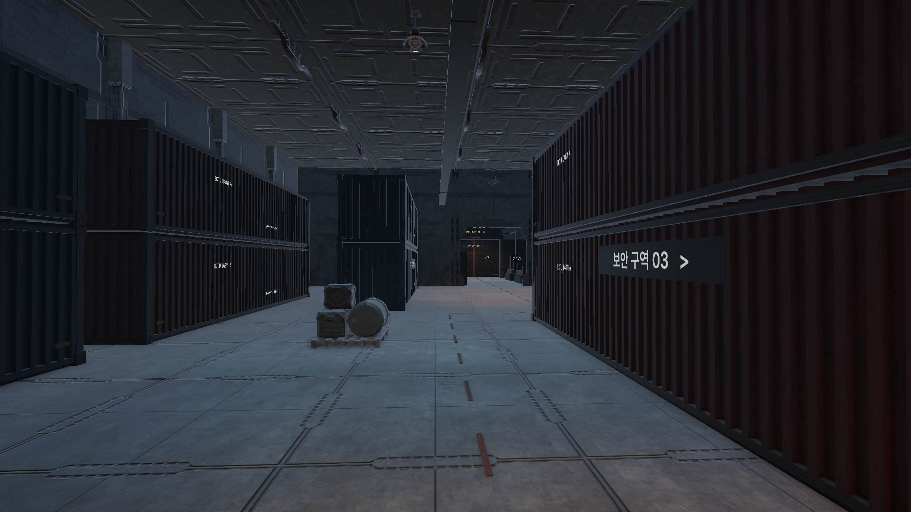
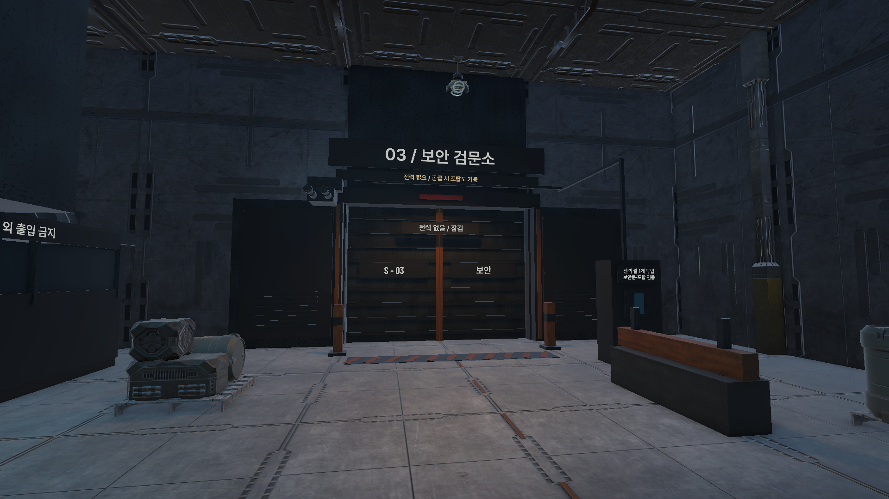
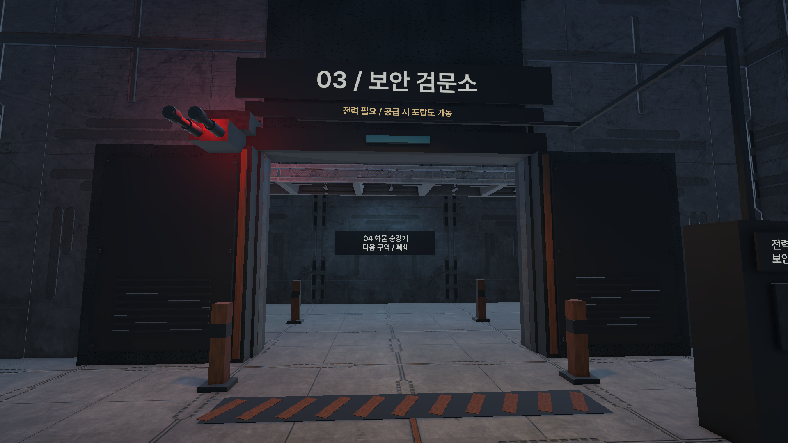
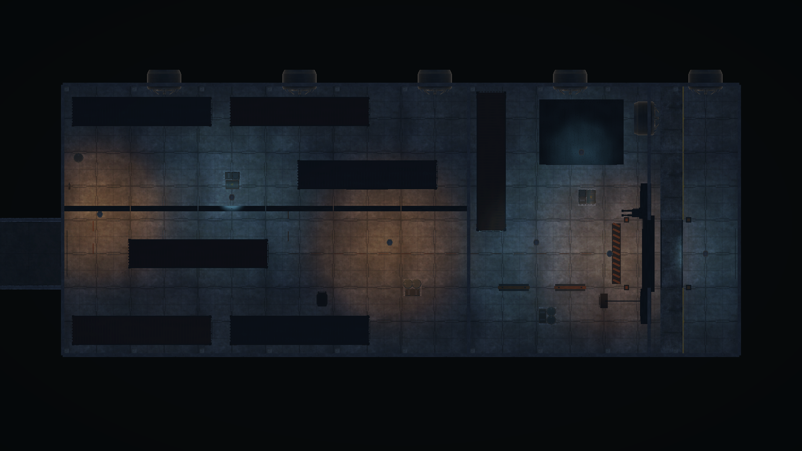

# 컨테이너 통로·보안 게이트 제작 및 검수

기존 인트로에 컨테이너 통로와 보안 게이트를 연결한 환경 장면이다. `CargoStation.unity`를 열면 확인할 수 있다. 기존 `testScene.unity`, `Intro.prefab`, 플레이어 입력 코드는 이번 작업에서 수정하지 않았다.

## 결과 위치

- 완성 장면: [CargoStation.unity](../../BlackOut/Assets/BLACKOUT/Scenes/Levels/CargoStation.unity)
- 재사용 프리팹: [CargoStation](../../BlackOut/Assets/BLACKOUT/Prefabs/Environment/CargoStation) — 컨테이너 3색, 보안 게이트 1종
- 재질·결합 메시·표면 텍스처: [Art/CargoStation](../../BlackOut/Assets/BLACKOUT/Art/CargoStation)
- [에셋 출처와 기술 정보](../assets/BLACKOUT_CargoStation_Manifest.json)
- [자동 검사 결과](../images/production/cargo-station/validation.json), [실제 Hierarchy 목록](../images/production/cargo-station/hierarchy.txt)

## 기획과 공간

[게임 기획서](../planning/BLACKOUT_PRD.md)의 컨테이너 통로와 보안 게이트 구간을 기준으로 제작했다. [아트 바이블](../art-direction/BLACKOUT_ArtBible.md)의 어두운 산업 시설, 황토색 안전 표식, 청록색 전력, 빨간 위험 표시를 따랐다.

- 컨테이너 통로: 36 × 24m. 인트로 동쪽 출구에서 연결되며 컨테이너 적재물로 시야를 나누고 꺾인 경로, 회복 공간, 엄폐 모서리를 배치했다. 전체 구역이 한 줄짜리 강제 통로는 아니다.
- 보안 게이트: 24 × 24m. 검문 부스, 검사 화물, 충돌 방지 시설, 6m 폭 양개문, 전력함, 공유 전선, 포탑 외형, 상부 점검 발판을 배치했다.
- 컨테이너: 40피트 비례인 12.19 × 2.60 × 2.44m 본체. 아래쪽 중앙이 배치 기준이며, 골판·프레임·잠금봉·물류 표기를 포함한다. 반복 골판은 메시로 합쳐 Hierarchy가 수백 개 조각으로 늘어나지 않게 했다.
- 적 등장·잔류 전력·전력함 접근·다음 구역 연결 위치는 `GameplayAnchors`에 비어 있는 위치 표시 오브젝트로 준비했다. 실제 적이나 상호작용 기능은 아니다.

## Hierarchy 원칙

```text
BLACKOUT_CargoStation
├─ Environment
│  ├─ 01_LoadingBay
│  ├─ 02_ContainerCorridor
│  │  ├─ Architecture
│  │  │  ├─ FloorGrid
│  │  │  ├─ PerimeterWalls
│  │  │  ├─ RoofAndTrusses
│  │  │  └─ StructuralColumns
│  │  ├─ CargoStacks
│  │  ├─ MaintenanceAndCover
│  │  ├─ Facilities
│  │  ├─ Wayfinding
│  │  ├─ OverheadServices
│  │  ├─ Lighting
│  │  └─ GameplayAnchors
│  └─ 03_SecurityGate
│     ├─ Architecture
│     ├─ Facilities
│     │  ├─ SecurityGate_PowerLinked
│     │  └─ InspectionBooth
│     ├─ InspectionCargoAndBarriers
│     ├─ Wayfinding
│     ├─ Lighting
│     └─ GameplayAnchors
└─ Presentation
   └─ Main Camera
```

벽과 바닥은 서로 다른 부모 아래에, 컨테이너는 적재 묶음 아래에 배치한다. `Bay_01_02`와 같은 번호는 해당 부모 안에서 모듈 위치를 구별하는 용도다. 기존 인트로는 새 장면에 복사한 바깥 프리팹 연결만 풀고 분류했으며, 원본 프리팹과 내부 창고 모듈은 보존했다.

## 직접 확인하기

안내 문구는 한국어이며 Pretendard SemiBold를 사용한다. 컨테이너 식별번호와 `S-03` 같은 설비 코드는 유지했다. 한글 깨짐과 간판 영역 넘침은 `6 Validate Korean signs`로 검사한다. `5 Apply Korean signs`는 간판 문구·폰트·크기만 다시 적용한다.

장면 내 한국어 표시 42개를 적용했으며, [한글 검사 결과](../images/production/cargo-station/korean-sign-validation.json)와 [실행 모드 화면](../images/production/cargo-station/07-playmode.png)을 함께 보관한다. 비활성 안내판은 Unity가 글자 메시 생성을 미루므로 글자 크기 검사는 화면에 활성화된 안내판을 대상으로 한다. 글꼴·문자 지원 검사는 비활성 안내판도 포함한다.

1. Unity에서 `CargoStation.unity`를 연다. 확인할 구역을 Hierarchy에서 선택하고 `F`를 눌러 이동한다.
2. 게이트를 선택하고 `BlackoutSecurityGatePreview`의 `Powered`를 바꾸거나, 컴포넌트 메뉴의 `Preview / Powered`와 `Preview / Blackout`을 사용한다.
3. 정전 상태에서는 문이 닫히고 포탑 경고등이 꺼진다. 전력 상태에서는 문이 벽의 수납부로 이동하고 포탑 경고등이 켜진다.
4. `BLACKOUT > Cargo Station > 2 Validate routes and references`로 이동·참조 검사를 다시 실행한다.
5. `3 Capture review cameras`로 검수 카메라 6장을 다시 저장한다. 실제 Unity 렌더이며 콘셉트 이미지가 아니다.

`1 Create connected scene`은 장면 파일이 없을 때만 실행한다. 이미 제작된 장면을 덮어쓰지 않는다. `4 Apply inspected refinements`는 제작 단계 보정용이며, 이후 직접 바꾼 조명 값을 보존하려면 다시 실행하지 않는다.

## 스스로 검수하고 수정한 내용

| 발견한 문제 | 반영한 수정 |
|---|---|
| 인트로 프리팹의 저장 위치가 `(5.5, 1.9, 0)`여서 바닥과 출구가 어긋남 | 새 장면의 인트로만 원점에 정렬하고 끝막이를 비활성화 |
| 게이트 뒤 발판의 큰 충돌 범위가 바닥 통로를 막음 | 해당 구간을 상부 데크와 난간으로 교체하고 충돌 범위를 데크에 맞춤 |
| 간판 글자가 벽 너머로 보임 | 깊이를 검사하는 전용 글자 셰이더 적용 |
| 컨테이너 끝면이 평평하고 조명에서 형태가 잘 안 보임 | 끝면 골판, 표면 도장 변화, 측면 작업등 추가 |
| 열린 문의 보강대가 옆 벽에 겹쳐 보임 | 문 수납부 외장·점검 패널·환기구 추가 |
| 포탑이 사각 블록 형태로만 보임 | 회전부, 원통형 총열·총구, 냉각 부품으로 보완 |
| 전력함 접근 위치가 캐비닛과 너무 가까움 | 접근 위치를 옮기고 별도 이동 경로 검사 추가 |

2026-09-30 검사: 반지름 0.4m, 높이 1.9m 사람 크기 충돌 검사와 0.35m 간격 바닥 검사를 사용했다. 주요 경로, 전력함 접근, 회복 공간 접근, 문 닫힘/열림 통행 판정이 모두 통과했다. 누락된 스크립트·재질·지원되지 않는 셰이더는 0개였다. 저장 후 다시 열기와 Play Mode에서도 새 오류가 없었다. Visual Studio 연결용 UDP 포트 경고는 남아 있으며 장면 오류와 구분한다.

## 실제 화면

아래는 초기 공간 제작 화면이다. 이후 적용한 재질과 최신 화면은 [화물역 재질 제작·적용 기록](BLACKOUT_CargoMaterials_Workflow.md)을 기준으로 확인한다.









## 남은 구현과 제한

- 환경 외형과 즉시 전환되는 상태 미리보기까지 완성했다. 셀 소비·회수, 상호작용 입력, 문 이동 애니메이션, 포탑 조준·발사, 적 AI는 미구현이다.
- 플레이어 이동 컨트롤러를 이 장면에 연결하지 않았으므로 Play 버튼만으로 걸어 다닐 수는 없다. 이동 검사는 실제 플레이어 대신 사람 크기 충돌체로 수행했다.
- 화물 승강기와 관제탑은 이번 추가 구역에 포함하지 않았다. 게이트 뒤쪽은 다음 구역 표시가 있는 막힌 연결 대기 공간이다.
- 1920×1080 화면 검수를 했지만 실제 플레이어 카메라·전투 중 가림, 목표 PC에서의 60fps, LOD와 조명 성능은 아직 검증하지 않았다. 제작용 최종 승인으로 표시하지 않는다.
- Unity 조작을 위해 `com.unity.pipeline` 0.8.0-exp.1 패키지를 추가했다. 제작 도구는 Editor 폴더에 있고, 장면 외형은 생성기를 실행하지 않아도 열린다.
