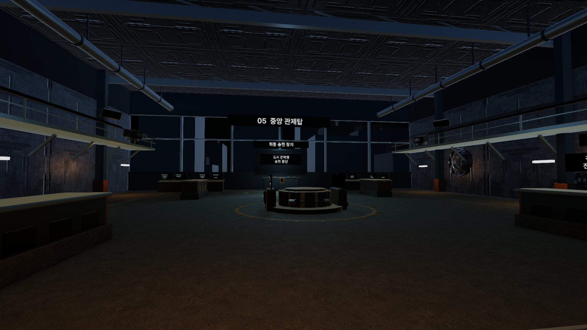
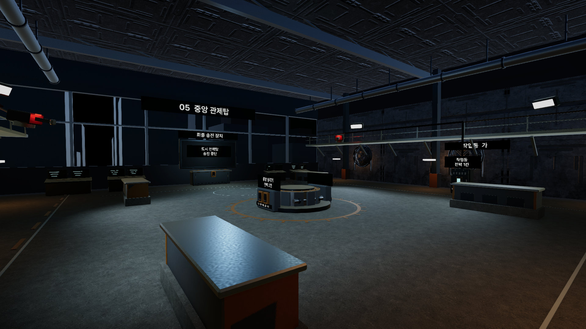
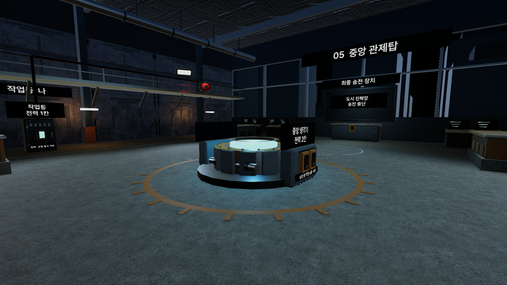
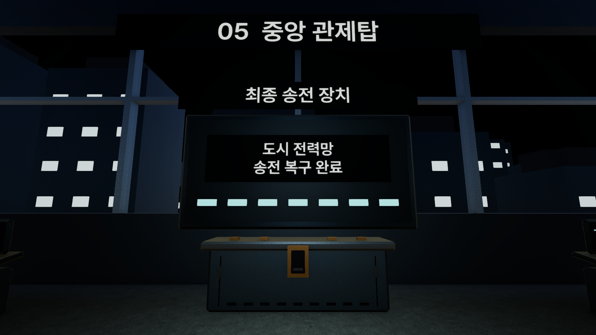

# 관제탑 보스전 공간 제작 기록

## 결과와 범위

기존 `CargoStation.unity` 뒤에 승강장과 위층 관제실을 연결했다. 기존 컨테이너 통로·보안 게이트는 유지하고, 보안 게이트 끝의 벽 한 칸만 비활성화해 연결했다. 비활성 벽은 복구할 수 있도록 남겨 두었다.

이번 작업은 **전투할 공간과 장치의 외형·상태 표현**이다. 보스 AI, 피해 판정, 전력 소비, 8초 타이머, 저장 및 승강기 이동은 구현하지 않는다. 점검 계단이 실제 연결 경로이며 승강기는 점검 중으로 표시한다.

## 위치

- 장면: `BlackOut/Assets/BLACKOUT/Scenes/Levels/CargoStation.unity`
- 관제탑: `BLACKOUT_CargoStation/Environment/05_ControlTower`
- 연결 구역: `BLACKOUT_CargoStation/Environment/04_FreightLiftArrival`
- 재사용 장치: `BlackOut/Assets/BLACKOUT/Prefabs/Environment/ControlTower/`
- 추가 메시·반사·관제탑 화면 설정: `BlackOut/Assets/BLACKOUT/Art/ControlTower/`
- 관제탑 전용 재질: `BlackOut/Assets/BLACKOUT/Art/Materials/ControlTower/`
- 기존 공용 재질: `BlackOut/Assets/BLACKOUT/Art/Materials/CargoStation/`
- 제작 코드: `BlackOut/Assets/BLACKOUT/Scripts/Editor/BlackoutControlTowerBuilder.cs`
- 검사 코드: `BlackOut/Assets/BLACKOUT/Scripts/Editor/BlackoutControlTowerVerification.cs`
- 미리보기: `BlackOut/Assets/BLACKOUT/Scripts/Runtime/Environment/BlackoutControlTowerPreview.cs`

## 배치 기준

기준 문서는 [기획서](../planning/BLACKOUT_PRD.md)와 [아트 바이블](../art-direction/BLACKOUT_ArtBible.md)이다. 바닥은 기존보다 6m 높고, 관제실은 36×36m, 천장 높이는 바닥에서 12m다. 중앙 냉각 장치 주변과 사방 이동로를 비워 두며, 양옆의 네 엄폐물 뒤에서 작업등까지 접근할 수 있다.

| 대상 | 위치 / 역할 |
|---|---|
| 입구 | `(111, 6, 27)` — 점검 계단에서 진입 |
| 보스 배치점 | `(134, 6, 24)` — 실제 보스 모델·행동은 별도 |
| 중앙 냉각 장치 | `(126, 6, 24)` — 2칸 소켓, 앞·뒤 접근 |
| 작업등 가 / 나 | `(122, 6, 9.6)` / `(122, 6, 38.4)` — 각 1칸 소켓 |
| 송전 복구 장치 | `(142, 6, 24)` — 창가 관제석 중앙 |
| 정비·저장 지점 | 승강장 계단 아래 — 기능 연결용 위치 제공 |

작업등을 켜면 같은 회로의 포탑 경고 표시도 켜진다. 중앙 냉각 장치는 덮개가 열린 모습과 닫힌 모습으로 구분한다. 송전 복구 시 관제 화면과 창밖 건물의 창 조명이 바뀐다. 이들은 **환경 상태 미리보기**이며 실제 게임의 전력 시스템이 아니다.

## 오브젝트 구조

```text
Environment
├─ 04_FreightLiftArrival
│  ├─ Architecture / LowerFloor / Envelope / MaintenanceStair
│  ├─ FreightLift_VisualOnly
│  ├─ BossPreparation
│  ├─ Wayfinding
│  ├─ GameplayAnchors
│  └─ Lighting
└─ 05_ControlTower
   ├─ Architecture
   │  ├─ ArenaFloor / Envelope / ObservationFacade
   │  ├─ StructuralColumns / RoofAndTrusses
   │  └─ ServiceGalleries / OverheadServices
   ├─ CombatLayout / 네 엄폐 구역 / FloorMarkings
   ├─ Facilities
   │  ├─ South_WorklightCircuit / North_WorklightCircuit
   │  ├─ 각 회로의 LightAndTurretRig
   │  ├─ CentralCooling_TwoCell
   │  ├─ GridRestorationConsole
   │  └─ OperatorConsoleBanks
   ├─ Lighting
   ├─ ExteriorVista_NonPlayable
   ├─ Wayfinding
   └─ GameplayAnchors
```

## Unity에서 확인

1. `CargoStation.unity`를 연다.
2. Hierarchy에서 `05_ControlTower`를 선택하고 `F`를 눌러 이동한다.
3. `Blackout Control Tower Preview` 컴포넌트의 메뉴에서 `미리보기/정전`, `양쪽 작업등과 포탑`, `중앙 냉각 가동`, `도시 송전 복구`를 선택한다.
4. 검사·화면 저장은 상단 `BLACKOUT > Control Tower` 메뉴를 사용한다. 생성 메뉴는 기존 관제탑을 덮어쓰지 않는다.

새 장면에서 동일 결과를 재현할 때의 코드 호출 순서는 `Build → Refine → FinalizeLighting → BakeReflection → Validate → Capture`다. `Refine`도 중복 적용을 거부한다. 완성된 현재 장면에는 다시 생성/보강하지 말고 검사 또는 미리보기만 사용한다.

## 검수

실제 Unity 1920×1080 화면과 검증 결과를 `docs/images/production/control-tower/`에 저장했다.

| 검사 | 결과 |
|---|---|
| 보안 게이트 뒤 연결 → 계단 → 관제탑 | 사람 크기 충돌체 경로 검사 통과 |
| 사방 순환 / 좌우 작업등 / 냉각 장치 앞뒤 / 송전 장치 / 정비 지점 | 바닥·몸체 통과 검사 통과 |
| 실제 실행 중 계단 상승·전투장 한 바퀴 | 임시 CharacterController로 통과 |
| 정전 / 한쪽 전력 / 양쪽 전력 / 냉각 / 복구 | 시각 상태 연결 검사 통과 |
| 한글 안내 19개 / 재질 / 스크립트 | 누락 0 |
| 저장 후 다시 열기 | 반사 이미지 유지, 관제탑 전용 화면 효과 3개 유지 |

[환경 검사 결과](../images/production/control-tower/validation.json) · [실행 검사 결과](../images/production/control-tower/playmode-validation.json) · [실제 오브젝트 구조](../images/production/control-tower/hierarchy.txt)

검사에서 냉각 조작함이 남쪽 접근 동선을 침범한 것을 찾아 안쪽으로 0.35m 이동했다. 위층 아래로 보이던 빈 틈은 기초 벽으로 막았다. 소품 모서리를 깎고, 배관 연결부·볼트·손잡이·환기구를 추가했다. 합칠 수 있는 장식을 묶어 새 구역의 정전 상태 렌더러 수를 590개에서 387개로 줄였다. 이 수치는 GPU 성능 측정이나 60fps 보증이 아니다.

관제탑 그림자는 주요 스폿 조명 1개만 사용한다. 처음 사용한 포인트 조명의 그림자 6면을 1면으로 줄여 그림자 공간 부족 경고를 없앴다. 검수 시 관제탑·승강장의 기본 활성 조명은 12개이고, 작업등·냉각 상태의 조명은 별도로 켜진다.

화면 보정은 `Lighting/ArenaLocalGrade`의 지역 Volume만 사용한다. 설정 파일은 `Art/ControlTower/ControlTowerVolume.asset`, 효과는 ACES, 노출 +0.3, 대비 7, 채도 -5, 약한 Bloom 0.12다. Main Camera의 후처리와 FXAA를 켰으며 Volume은 Default 레이어다. 기존 구역의 화면 설정 파일은 수정하지 않았다. 제거하려면 `ArenaLocalGrade`를 비활성화하고 카메라의 Anti-aliasing을 None으로 되돌린다.

### 실제 화면









[작업등·연동 포탑](../images/production/control-tower/04-worklight-circuit.png) · [점검 계단](../images/production/control-tower/06-arrival-stair.png) · [상부 배치도](../images/production/control-tower/07-layout-cutaway.png) · [실행 화면](../images/production/control-tower/08-playmode-blackout.png)

### 남은 게임 구현

- 실제 보스 모델·애니메이션·공격과 약점 피해
- 소켓 상호작용, 전력 소비·회수와 냉각 8초 제한
- 플레이어 이동·카메라·전투 연결과 실사용 테스트
- 보스전 출입문, 저장·회복 기능, 실제 승강기 이동
- 목표 PC에서 프레임·메모리 측정, 필요 시 거리별 표시·조명 최적화

장치 프리팹은 냉각 장치와 송전 콘솔 2개다. 각각 바닥 중심이 원점이며 송전 콘솔 프리팹에는 창밖 도시를 포함하지 않는다. 작업등과 포탑은 회로별 장면 그룹으로 관리한다.

## 출처

[관제탑 에셋 원장](../assets/BLACKOUT_ControlTower_Manifest.json), [기존 재질 원장](../assets/BLACKOUT_CargoMaterials_Manifest.json)을 따른다. 기존 창고 키트와 Pretendard 라이선스는 유지하며, 외부 모델을 새로 내려받지는 않았다.
