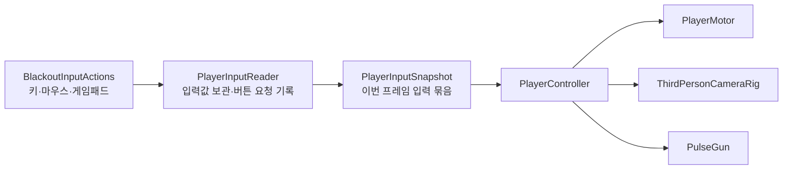

# BLACKOUT — PlayerInputReader 구현 가이드

`BlackoutInputActions`는 입력표이고, `PlayerInputReader`는 그 표를 읽어 게임 코드가 쓸 수 있는 값으로 바꾸는 컴포넌트다. Reader가 없으면 이동 코드·카메라 코드·총 코드가 각각 키보드와 마우스를 직접 읽게 되어, 메뉴를 열었을 때 입력을 끄거나 키를 바꾸는 일이 어려워진다.

> 대상: Unity 6000.3.22f1 · Input System 1.20.0\
> \
> 선행 문서: [Input Actions 설정 따라 하기](BLACKOUT_InputActionsSetup.md)\
> \
> 연결 문서: [TPS 플레이어 이동·조준·펄스 발사 구현 가이드](BLACKOUT_TPSPlayerMovementAndPulseFire.md)\
> \
> 현재 확인: `Assets/BLACKOUT/Settings/BlackoutInputActions.inputactions`와 자동 생성된 `BlackoutInputActions.cs`가 존재한다. `Gameplay`에는 Move, Look, Jump, Aim, Fire, Interact가 설정되어 있다.

## 1. Reader가 해결하는 문제

직접 작성한 현재 Reader를 검증하는 실습은 [T01 입력 수집 검증](implementation/01-input.md)에 있다. 입력을 실제 이동과 사격으로 잇는 다음 순서는 [구현 태스크 목록](implementation/README.md)에서 확인한다.

아래처럼 각 기능이 자기 방식으로 키를 읽으면, 같은 클릭이 여러 곳에서 다르게 처리될 수 있다.

```text
PlayerMotor    → W, A, S, D 직접 확인
CameraRig      → Mouse Delta 직접 확인
PulseGun       → Left Mouse Button 직접 확인
Interaction    → E 직접 확인
```

이 구조에서는 메뉴가 열린 동안 이동은 멈췄는데 총은 발사되거나, 게임패드를 추가할 때 네 곳을 모두 고쳐야 할 수 있다.

Reader를 두면 입력 장치와 게임 규칙 사이에 하나의 번역 지점이 생긴다.



Reader는 **입력을 읽고 보관만 한다.** 이동시키거나 발사체를 만들거나 체력을 바꾸지 않는다.

## 2. 현재 입력 에셋과 생성 코드 확인

현재 에셋에는 아래 입력이 실제로 만들어져 있다.

| Map      | Action   | 현재 Binding                     |
| -------- | -------- | ------------------------------ |
| Gameplay | Move     | W, A, S, D 2D Vector Composite |
| Gameplay | Look     | Mouse Delta                    |
| Gameplay | Jump     | Space                          |
| Gameplay | Aim      | Mouse Right Button             |
| Gameplay | Fire     | Mouse Left Button              |
| Gameplay | Interact | E                              |

`BlackoutInputActions.cs`는 Unity가 `.inputactions` 파일에서 자동 생성한 코드다. `BlackoutInputActions`, `Gameplay`, `IGameplayActions`, `OnMove` 같은 이름은 이 파일에서 온다.

```text
BlackoutInputActions.inputactions
             ↓ Unity가 자동 생성
BlackoutInputActions.cs
             ↓ Reader가 사용
PlayerInputReader.cs
```

자동 생성 파일은 수정하지 않는다. 입력을 추가하거나 이름을 바꾸면 Unity가 다시 생성하며, 직접 쓴 내용은 사라질 수 있다. 우리가 작성할 파일은 다음 경로다.

```text
Assets/BLACKOUT/Scripts/Runtime/Gameplay/Player/PlayerInputReader.cs
```

## 3. 핵심 개념: 계속 값과 한 번 요청을 다르게 다룬다

입력에는 두 종류가 있다.

| 종류     | Action               | Reader가 처리하는 방식                           | 예시                     |
| ------ | -------------------- | ----------------------------------------- | ---------------------- |
| 계속 값   | Move, Look, Aim      | 최신 상태를 보관                                 | 지금 이동 방향, 현재 조준 중인지    |
| 한 번 요청 | Jump, Fire, Interact | 다음 `CaptureSnapshot()`까지 요청을 보관한 뒤 한 번 소비 | 점프 시작, 한 발 발사, 상호작용 시작 |

`Fire`를 예로 들면, 마우스 클릭은 매우 짧을 수 있다. 총 코드가 실행되는 순간에만 버튼 상태를 확인하면 클릭을 놓칠 수 있다. 그래서 Reader는 “발사 요청이 있었음”을 기록하고, `PlayerController`가 한 프레임의 입력 묶음을 가져갈 때 딱 한 번 전달한다.

```typescript
마우스 클릭
  ↓
OnFire(performed): fireRequested = true
  ↓
PlayerController.Update
  ↓
CaptureSnapshot(): FirePressed = true 전달
  ↓
fireRequested = false
```

이 방식은 기본 펄스 발사처럼 한 번 눌러 한 번 실행할 때 적합하다. 충전 사격은 이후 `Fire`의 시작·유지·해제 시간을 별도 상태로 확장한다.

## 4. 파일별 책임

| 파일                                  | 책임                             | 직접 해서는 안 되는 일            |
| ----------------------------------- | ------------------------------ | ------------------------ |
| `BlackoutInputActions.inputactions` | 키·마우스와 행동을 연결                  | 이동 속도·무기 피해 설정           |
| `BlackoutInputActions.cs`           | Unity가 입력표를 C# API로 생성         | 직접 수정                    |
| `PlayerInputReader.cs`              | Action 콜백을 받고 스냅샷으로 전달         | 이동, 카메라 회전, 발사체 생성       |
| `PlayerController.cs`               | Reader에서 스냅샷을 한 번 받고 호출 순서를 정함 | 키보드 직접 확인                |
| `PlayerMotor.cs`                    | Move 값을 실제 이동으로 변환             | Mouse·Keyboard API 직접 호출 |
| `PulseGun.cs`                       | Fire 요청과 쿨다운을 검사해 발사           | Input System 콜백 직접 구독    |

## 5. 먼저 생각할 질문

코드를 붙이기 전에 아래를 답해 본다.

1. 메뉴를 연 직전에 클릭했다면, 메뉴를 닫을 때 그 클릭으로 총이 발사되면 안 되는가?
2. `OnEnable` 때마다 콜백을 등록하면 Play Mode 재시작 또는 프리팹 재활성화 뒤 어떤 일이 생기는가?
3. Jump는 누르고 있는 동안 매 프레임 점프해야 하는가, 한 번 요청해야 하는가?
4. Aim은 클릭 한 번의 요청인가, 누르고 있는 상태인가?
5. 입력을 끌 때 이전 프레임의 Move·Fire 값은 어떻게 해야 하는가?

BLACKOUT의 답은 다음이다: Gameplay 입력을 끌 때 보관한 값을 지우고, Jump·Fire·Interact는 한 번 요청으로, Aim은 계속 상태로 다룬다.

## 6. 설계 결정

### 6.1 `IGameplayActions` 콜백 인터페이스를 사용한다

생성된 `BlackoutInputActions.cs`에는 `BlackoutInputActions.IGameplayActions`가 있고, 다음 메서드를 요구한다.

```text
OnMove, OnLook, OnJump, OnAim, OnFire, OnInteract
```

`PlayerInputReader`가 이 인터페이스를 구현하고 `Gameplay.AddCallbacks(this)`를 한 번 호출한다.

| 선택                             | 장점                                  | 비용                                  |
| ------------------------------ | ----------------------------------- | ----------------------------------- |
| 생성 인터페이스 구현: **채택**            | Action 이름 변경과 누락을 컴파일 오류로 빠르게 찾기 쉽다 | Action마다 메서드를 작성해야 한다               |
| 문자열로 Action 찾기                 | 짧게 시작할 수 있다                         | 이름 오타가 실행 중에야 드러나기 쉽다               |
| `PlayerInput` 컴포넌트의 UnityEvent | Inspector에서 보기 쉽다                   | 이벤트 연결이 여러 프리팹에 퍼지면 흐름 추적이 어려울 수 있다 |

`PlayerInput`은 나쁜 선택이 아니다. 프로토타입이나 UI 연결에 유용하다. BLACKOUT에서는 입력 흐름과 수명 관리를 직접 이해하기 위해 생성 클래스와 Reader 방식을 먼저 사용한다.

### 6.2 등록은 Awake, 활성화는 OnEnable에서 분리한다

```typescript
Awake      : 입력 객체 생성, 콜백 1회 등록
OnEnable   : Gameplay Map 활성화
OnDisable  : Gameplay Map 비활성화, 남은 입력값 삭제
OnDestroy  : 콜백 제거, 입력 객체 Dispose
```

`OnEnable`에 `AddCallbacks`를 넣지 않는 이유는 오브젝트가 꺼졌다 켜질 때마다 같은 메서드가 중복 등록될 수 있기 때문이다. 생성된 코드가 중복 등록을 방지하더라도, 이 수명 규칙을 명확하게 유지하는 편이 안전하다.

## 7. 의사코드

```typescript
Awake:
  BlackoutInputActions 생성
  Gameplay 콜백을 Reader 자신에게 한 번 등록

OnEnable:
  Gameplay Map 활성화

OnMove / OnLook:
  최신 Vector2 값을 보관

OnJump / OnFire / OnInteract:
  performed일 때만 한 번 요청 플래그를 true로 기록

OnAim:
  현재 버튼이 눌렸는지 여부를 보관

CaptureSnapshot:
  현재 Move·Look·Aim과 요청 플래그를 새 Snapshot으로 복사
  Jump·Fire·Interact 요청 플래그는 false로 비움
  Snapshot 반환

OnDisable:
  Gameplay Map 비활성화
  Move·Look·Aim·모든 요청 플래그 삭제

OnDestroy:
  콜백 제거
  입력 객체 Dispose
```

## 8. 최소 구현 코드

아래는 현재 생성된 `BlackoutInputActions`와 정확히 맞는 출발 코드다. `Player.cs`를 덮어쓰지 않고 새 `PlayerInputReader.cs` 파일에 작성한다.

```csharp
using UnityEngine;
using UnityEngine.InputSystem;

public readonly struct PlayerInputSnapshot
{
    public static PlayerInputSnapshot None => new(
        Vector2.zero, Vector2.zero, false, false, false, false);

    public PlayerInputSnapshot(
        Vector2 move,
        Vector2 look,
        bool isAiming,
        bool jumpPressed,
        bool firePressed,
        bool interactPressed)
    {
        Move = move;
        Look = look;
        IsAiming = isAiming;
        JumpPressed = jumpPressed;
        FirePressed = firePressed;
        InteractPressed = interactPressed;
    }

    public Vector2 Move { get; }
    public Vector2 Look { get; }
    public bool IsAiming { get; }
    public bool JumpPressed { get; }
    public bool FirePressed { get; }
    public bool InteractPressed { get; }
}

public sealed class PlayerInputReader : MonoBehaviour,
    BlackoutInputActions.IGameplayActions
{
    private BlackoutInputActions _actions;

    private Vector2 _move;
    private Vector2 _look;
    private bool _isAiming;
    private bool _jumpRequested;
    private bool _fireRequested;
    private bool _interactRequested;
    private bool _gameplayEnabled;

    private void Awake()
    {
        _actions = new BlackoutInputActions();
        _actions.Gameplay.AddCallbacks(this);
    }

    private void OnEnable()
    {
        SetGameplayEnabled(true);
    }

    private void OnDisable()
    {
        SetGameplayEnabled(false);
    }

    private void OnDestroy()
    {
        _actions.Gameplay.RemoveCallbacks(this);
        _actions.Dispose();
    }

    public void SetGameplayEnabled(bool enabled)
    {
        _gameplayEnabled = enabled;

        if (enabled)
        {
            _actions.Gameplay.Enable();
            return;
        }

        _actions.Gameplay.Disable();
        ClearAllInput();
    }

    public PlayerInputSnapshot CaptureSnapshot()
    {
        if (!_gameplayEnabled)
        {
            return PlayerInputSnapshot.None;
        }

        var snapshot = new PlayerInputSnapshot(
            _move,
            _look,
            _isAiming,
            _jumpRequested,
            _fireRequested,
            _interactRequested);

        _jumpRequested = false;
        _fireRequested = false;
        _interactRequested = false;

        return snapshot;
    }

    public void OnMove(InputAction.CallbackContext context)
    {
        _move = context.ReadValue<Vector2>();
    }

    public void OnLook(InputAction.CallbackContext context)
    {
        _look = context.ReadValue<Vector2>();
    }

    public void OnJump(InputAction.CallbackContext context)
    {
        if (context.performed)
        {
            _jumpRequested = true;
        }
    }

    public void OnAim(InputAction.CallbackContext context)
    {
        _isAiming = context.ReadValueAsButton();
    }

    public void OnFire(InputAction.CallbackContext context)
    {
        if (context.performed)
        {
            _fireRequested = true;
        }
    }

    public void OnInteract(InputAction.CallbackContext context)
    {
        if (context.performed)
        {
            _interactRequested = true;
        }
    }

    private void ClearAllInput()
    {
        _move = Vector2.zero;
        _look = Vector2.zero;
        _isAiming = false;
        _jumpRequested = false;
        _fireRequested = false;
        _interactRequested = false;
    }
}
```

## 9. 코드가 하는 일

### 9.1 Snapshot은 왜 구조체인가

`PlayerInputSnapshot`은 “이번 프레임에 플레이어가 의도한 조작”만 담는 작은 값이다. 참조를 공유하는 클래스 대신 값 형식 구조체로 만들면, `PlayerController`가 받은 입력 묶음이 Reader 내부의 다음 입력 변화로 바뀌지 않는다.

### 9.2 `context.performed`를 확인하는 이유

생성된 콜백은 버튼을 누를 때뿐 아니라 시작·수행·취소 순간에도 호출될 수 있다. Jump·Fire·Interact에서 모든 호출을 요청으로 처리하면, 버튼을 뗄 때도 요청이 생길 수 있다.

```csharp
if (context.performed)
{
    _fireRequested = true;
}
```

이 조건은 “발사 행동이 실제로 수행된 순간만” 기록한다.

### 9.3 Aim은 왜 요청이 아닌 상태인가

조준은 클릭 한 번으로 끝나는 행동이 아니다. 마우스 오른쪽 버튼을 누르고 있는 동안 카메라 거리·몸 방향·이동 속도가 바뀐다. 그래서 `ReadValueAsButton()`으로 현재 상태를 저장한다. 버튼을 떼면 canceled 콜백에서 자연스럽게 false가 된다.

### 9.4 `CaptureSnapshot()`이 요청을 비우는 이유

Fire 요청을 전달한 뒤 false로 바꾸지 않으면, 다음 프레임에도 같은 클릭이 남아 두 발 이상 발사될 수 있다. Move와 Aim은 계속된 상태이므로 비우지 않는다.

### 9.5 입력을 끌 때 모든 값을 지우는 이유

메뉴를 열거나 사망하면 `SetGameplayEnabled(false)`를 호출하게 된다. 이때 이전 프레임의 Fire 요청을 지우지 않으면, 메뉴를 닫은 뒤 과거 클릭으로 총이 발사될 수 있다.

## 10. PlayerController와 연결하는 최소 형태

다음 단계에서 `PlayerController`는 Input System을 알 필요 없이 Reader에게 Snapshot만 요청한다.

```csharp
public sealed class PlayerController : MonoBehaviour
{
    [SerializeField] private PlayerInputReader inputReader;

    private void Update()
    {
        PlayerInputSnapshot input = inputReader.CaptureSnapshot();

        // 다음 단계에서 이 순서로 연결한다.
        // cameraRig.ApplyLook(input.Look);
        // motor.Tick(input.Move, input.JumpPressed, cameraRig.PlanarBasis);
        // facing.Tick(input.IsAiming, motor.PlanarVelocity, cameraRig.PlanarForward);
        // pulseGun.TryFire(input.FirePressed, cameraRig.AimRay);
    }
}
```

Reader와 `PlayerController`가 같은 Player_Root 프리팹에 있어도, Inspector의 `inputReader` 필드에 명시적으로 연결한다. `FindFirstObjectByType` 같은 전역 검색으로 매번 찾지 않는다.

## 11. Inspector에서 붙이는 순서

1. `Assets/BLACKOUT/Scripts/Runtime/Gameplay/Player/`에 `PlayerInputReader.cs`를 만든다.
2. 코드를 붙이고 Unity Console에 컴파일 오류가 없는지 확인한다.
3. Player_Root에 `PlayerInputReader` 컴포넌트를 붙인다.
4. 아직 `PlayerController`가 없다면 Reader만 붙여도 된다. 이 단계에서 캐릭터가 자동으로 움직이지 않는 것은 정상이다.
5. 다음에 `PlayerController`를 만들고 Reader를 Inspector에 연결한다.

`BlackoutInputActions.cs`는 Project Settings 폴더에 있는 자동 생성 파일이다. Player_Root에 붙이는 MonoBehaviour가 아니다.

## 12. 테스트 방법

### 12.1 임시 확인 로그

이 로그는 입력 에셋이 제대로 읽히는지 잠깐 확인할 때만 사용한다. 정상 확인 뒤에는 제거하거나 개발 표시로 바꾼다.

```csharp
private void Update()
{
    PlayerInputSnapshot input = CaptureSnapshot();

    if (input.FirePressed)
    {
        Debug.Log("Fire request received");
    }
}
```

| 확인    | 조작                                | 기대 결과                                   |
| ----- | --------------------------------- | --------------------------------------- |
| Move  | W를 누르고 뗀다                         | 값이 `(0, 1)`에 가까웠다가 `Vector2.zero`로 돌아간다 |
| Look  | 마우스를 움직인다                         | Look 값이 움직인 방향과 크기를 가진다                 |
| Jump  | Space를 한 번 누른다                    | 요청이 한 번만 전달된다                           |
| Aim   | 우클릭을 누르고 뗀다                       | 누르는 동안 true, 뗀 뒤 false다                 |
| Fire  | 좌클릭을 한 번 누른다                      | 요청이 한 번만 전달된다                           |
| 입력 차단 | `SetGameplayEnabled(false)`를 호출한다 | 이동·조준·발사 요청이 모두 전달되지 않는다                |
| 재활성화  | Player_Root를 껐다 켠다                | 클릭 한 번이 두 번 기록되지 않는다                    |

### 12.2 이 단계의 완료 기준

- [ ] Reader는 `BlackoutInputActions.IGameplayActions`를 구현한다.
- [ ] 콜백 등록은 Awake에서 한 번, 해제는 OnDestroy에서 한 번 이뤄진다.
- [ ] Gameplay Map은 OnEnable에서 켜지고 OnDisable에서 꺼진다.
- [ ] Move·Look·Aim은 최신 상태로 전달된다.
- [ ] Jump·Fire·Interact는 `CaptureSnapshot()` 뒤 한 번만 소비된다.
- [ ] 입력을 끈 뒤 이전 Fire·Jump 요청이 남지 않는다.
- [ ] Play Mode 재시작·Player_Root 재활성화 뒤 입력이 중복되지 않는다.

## 13. 자주 생기는 문제

| 증상                              | 흔한 원인                               | 확인과 해결                                                      |
| ------------------------------- | ----------------------------------- | ----------------------------------------------------------- |
| `BlackoutInputActions`를 찾을 수 없음 | 생성 코드가 없거나 컴파일 오류가 있음               | `.inputactions` Inspector의 Generate C# Class와 Console을 확인한다 |
| `IGameplayActions` 구현 오류        | Action 이름을 바꿨는데 Reader 메서드가 옛 이름임   | 생성 코드의 인터페이스 메서드 목록과 Reader를 맞춘다                            |
| 클릭 한 번에 두 발 요청                  | Reader를 둘 이상 붙였거나 콜백을 중복 등록함        | Player_Root의 Reader 수와 Awake/OnDestroy 수명을 확인한다             |
| 메뉴를 닫자마자 발사                     | 입력 차단 때 요청 플래그를 지우지 않음              | `SetGameplayEnabled(false)`에서 `ClearAllInput()`을 호출한다       |
| 우클릭을 뗐는데 조준 유지                  | Aim을 `performed`만 처리함               | Aim은 `ReadValueAsButton()`으로 현재 상태를 읽는다                     |
| 마우스 Look이 너무 빠르거나 느림            | Mouse Delta를 시간 보정·감도와 잘못 조합함       | CameraRig에서 감도를 분리하고, 마우스와 스틱을 실제로 각각 시험한다                  |
| Gamepad Look이 이상함               | Mouse Delta와 Stick을 완전히 같은 방식으로 처리함 | 게임패드 추가 시 Look 입력의 장치별 감도·누적 정책을 별도 검증한다                    |

## 14. 다음 확장 방향

| 기능    | Reader에서 추가할 내용                          | 지금 미리 넣지 않는 이유              |
| ----- | ---------------------------------------- | --------------------------- |
| 충전 사격 | Fire 시작 시간, 유지 상태, 해제 요청                 | 기본 Fire 한 번 소비 규칙을 먼저 확인한다  |
| 메뉴 UI | UI Action Map, Gameplay와의 전환             | UI가 실제로 생길 때 입력 충돌을 함께 시험한다 |
| 게임패드  | Move·Look·Button Binding, Control Scheme | 키보드·마우스 조작감을 먼저 고정한다        |
| 키 재지정 | Binding Override 저장·복원                   | 실제 변경 화면과 설정 저장 구조가 필요하다    |
| 사망·컷신 | GameFlow가 `SetGameplayEnabled(false)` 호출 | 사망 규칙을 Reader 안에 넣지 않는다     |

Reader 구현 뒤에는 [TPS 구현 문서의 이동·회전·점프 설계](BLACKOUT_TPSPlayerMovementAndPulseFire.md#8-%EC%9D%B4%EB%8F%99%ED%9A%8C%EC%A0%84%EC%A0%90%ED%94%84-%EC%84%A4%EA%B3%84)로 넘어가 `PlayerMotor`와 `PlayerController`를 연결한다.
