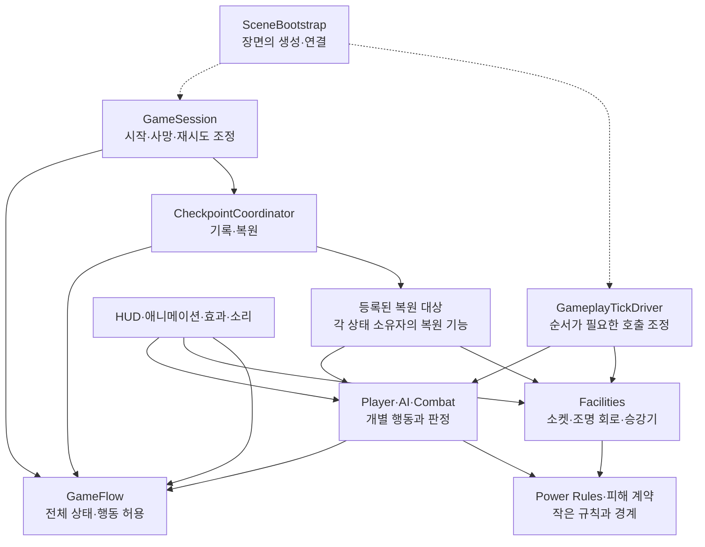
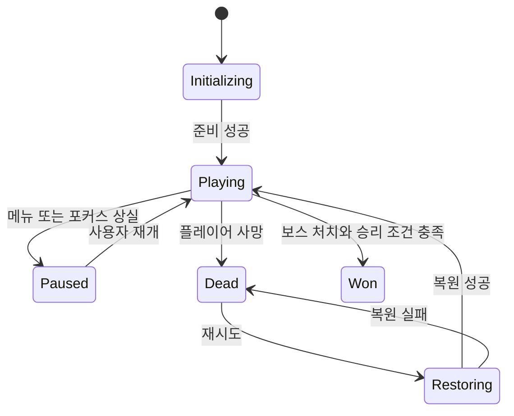

# BLACKOUT — 기술 설계

전력을 옮기는 중에 맞거나, 총을 충전한 채 죽거나, 시설을 켠 뒤 체크포인트로 돌아가도 게임의 값과 행동이 일관되어야 한다. 이를 위해 **각 기능의 책임, 값의 주인, 서로 연결하는 방향, 작업을 끝내는 순서**를 먼저 정한다.

> 버전: 0.1 · 작성: 2026-10-30 KST · 실습 계약 보완: 2026-11-06 · 상태: 구현 전 기술 설계 기준안
>
> 대상: `BlackOut` · Unity 6000.3.22f1 · URP 17.3.0 · Windows PC
>
> 이 문서는 설계 선택과 검증 계획이다. 아래 구조가 현재 구현되거나 실행 검증되었다는 뜻은 아니다. 이번 작업은 문서만 작성·연결한다.

## 문서 안내

- 요구와 게임 규칙: [PRD](../planning/BLACKOUT_PRD.md)
- 왜 이 역량을 준비하는가: [채용·포트폴리오 조사](BLACKOUT_PortfolioEngineeringResearch.md)
- 구현 연습: [태스크와 따라하기](implementation/README.md)
- 경로·프리팹 원칙: [프로젝트 구조](BLACKOUT_ProjectStructure.md)

찾아보기: [설계 목표](#goals) · [전체 구조](#architecture) · [시스템 책임](#responsibilities) · [상태 소유권](#ownership) · [의존 관계](#dependencies) · [시간·수명](#lifecycle) · [전력·복원](#critical-paths) · [선택과 대안](#decisions) · [검증·증거](#verification) · [기존 문서와 연결](#migration)

기획 규칙은 PRD를 따른다. 기술 구조의 통합 기준은 이 문서다. 기존 따라하기의 초기 코드는 학습 단계로 유지하고, 이 문서와 다른 통합 방식은 [마지막 절](#migration)의 변경 표를 확인한다. 기획을 보완해야 하는 항목은 기술 선택과 구분해 미정으로 표시한다.

## 현재 확인과 설계 범위

| 구분 | 2026-10-30 파일에서 확인한 내용 | 이 문서의 취급 |
|---|---|---|
| 입력 | 생성된 BlackoutInputActions와 직접 작성된 PlayerInputReader 존재 | 출발 코드; 입력 누락·포커스 정책은 검증 필요 |
| 플레이어 | Player.cs의 Start/Update에 행동 구현 없음 | 이동·전투 구조는 설계 대상 |
| 환경 | 화물역·관제탑 제작 기록과 Preview 스크립트 존재 | 공간·표시 참고; 전력 소비·보스 전투 완료 증거와 구분 |
| 패키지 | Input System 1.20.0, AI Navigation 2.0.14, Timeline 1.8.12 등 선언 | 설치 선언과 실제 기능 검증을 구분 |
| 실행 상태 | 이 작성 작업에서는 Unity Console·Play Mode·빌드 미확인 | 컴파일·성능 통과 주장 없음 |

기말의 같은 장면 10~15분 구간을 첫 통합 기준으로 삼는다. 이것은 프로젝트의 최종 성장 상한선이 아니다. 확장 실험은 기존 게임의 구조와 비교하고, 통합 필요가 확인되면 설계 기록을 갱신한다.

<a id="goals"></a>
## 1. 설계 목표와 기본 용어

### 1.1 구현할 행동에서 구조 요구를 도출한다

| 행동 요구 | 기술적으로 보장할 것 | 검증할 상황 |
|---|---|---|
| 이동하면서 조준·사격 | 위치·회전·카메라의 변경 담당과 순서가 분명함 | 벽·경사·급회전·저프레임 |
| 전력 0.7초 흡수, 피격 취소 | 진행과 지급 분리; 완료 때 조건 재검사 | 연타·피격·대상 소멸·가득 참 |
| 전력 주입·회수로 시설 변경 | 전력 이전 완료 후 일관된 통전 결과 공개 | 문·조명·포탑 상태 일치 |
| 사망 후 같은 장면 복원 | 기록 독립성, 작업 취소, 보상 재발행 방지 | 같은 기록 10회 복원 |
| 보스 단계·약점·공격 중단 | HP·단계·진행 중 공격의 주인이 분명함 | 예고 중 사망·50% 전환·냉각 종료 |
| Windows 1920×1080·60fps 목표 | 측정 경로·설정·병목을 비교 가능하게 기록 | 정전/통전·반복 전투·복원 |

최소 하드웨어와 메모리 예산은 아직 미정이다. 60fps의 약 16.67ms는 전체 프레임의 출발 예산이며, 현재 달성 수치가 아니다. 실제 Windows 기준 측정 후 기능별 예산과 느린 프레임의 허용 범위를 정한다.

### 1.2 문서에서 쓰는 말

| 말 | 쉬운 뜻 | 예 |
|---|---|---|
| 책임 | 해당 코드가 결정하고 처리할 일 | Health는 피해·체력·사망 판정 |
| 상태 | 실행 중 달라지는 값 | 현재 HP, 충전 시간 |
| 소유자 | 그 상태의 생성·변경·초기화를 책임질 곳 | 무기의 충전 시간은 PulseGun |
| 의존 | 상대의 타입·기능을 알아야 자기 일을 할 수 있음 | 탄환은 피해 전달 계약을 알아야 함 |
| 계약 | 주고받을 값과 성공·실패의 약속 | 피해 요청과 적용 여부 |
| 조립 | 필요한 상대를 연결하고 실행 준비를 마침 | 플레이어와 시설·UI 참조 연결 |
| 조정 | 여러 담당에게 정해진 순서로 일을 요청함 | 복원 전 중단→값 적용→재개 |
| 불변 규칙 | 정상 실행에서 항상 지켜야 하는 조건 | 일반 전력 이전의 합계 보존 |

“주인이 하나”라는 말은 다른 코드가 요청도 못 한다는 뜻이 아니다. 요청은 받을 수 있지만 **값을 직접 대입할 권한과 검증 경로를 제한**한다. 두 Store를 함께 바꾸는 전력 이전과 복원도 명시한 전용 경로를 통과한다.

<a id="architecture"></a>
## 2. 전체 구조 — 기능별 컴포넌트와 좁은 규칙 경계

게임을 기능별로 나누고, 각 기능 안에서 필요한 만큼 **규칙·Unity 연결·표시**를 구분한다. 전력 이전처럼 화면 없이 검증할 가치가 큰 규칙은 순수 C#으로 둔다. 이동·충돌·애니메이션은 Unity 컴포넌트를 명시적으로 사용한다.

아래 그림은 **앞으로 만들 의존 구조**다. 화살표는 플레이 진행 순서가 아니라 “왼쪽 코드가 오른쪽 기능을 참조·호출한다”는 뜻이다. 점선은 초기 조립 관계다.



그림은 묶음 수준의 지도다. 모든 객체가 Actors라는 공용 클래스를 참조한다는 뜻은 아니다. 실제 참조는 Health·PulseGun·FacilityPower 같은 좁은 대상으로 연결한다. UI가 바뀌어도 전력·피해 규칙이 UI를 수정하러 가지 않게 한다.

### 2.1 구조를 이루는 다섯 역할

| 역할 | 대표 대상 | 허용하는 일 | 맡기지 않는 일 |
|---|---|---|---|
| 조립 | SceneBootstrap | 참조 검사, 개별 상태 생성·연결, 준비 완료 | 매 발 피해 계산·적 행동 판단 |
| 전체 흐름·순서 | GameSession, GameFlow, GameplayTickDriver | 전환·행동 허용·필요한 호출 순서 | 전력 용량·중력·개별 공격 규칙 |
| 기능별 규칙 | 전력 이전, 피해, 충전·흡수, AI·시설 상태 | 요청 검증, 상태 변경, 결과 반환 | HUD·구체적인 효과 재생 |
| Unity 연결 | Motor, CameraRig, Projectile, NavMesh 연결 | 위치·충돌·시간·장면 개체 연결 | 저장 기록과 현재 상태의 혼용 |
| 표현·환경 연동 | HUD, Animator 연결, FacilityView, SFX/VFX | 현재 결과 조회·표시, 표현 시작/중단 | HP·전력·약점 판정의 임의 변경 |

이 역할을 다섯 개의 거대한 폴더나 기반 클래스로 강제하지 않는다. 기존 Gameplay/Presentation/Infrastructure/Editor 구조에 기능별로 배치한다. 기능 하나가 작으면 책임이 함께 바뀌는 코드는 같은 파일에 둬도 된다.

<a id="responsibilities"></a>
## 3. 각 시스템의 책임

표의 식별자는 구현 목표 이름이다. 현재 파일 존재 여부는 앞의 확인 표와 구분한다. “출력”은 반환값·상태 알림·실제 행동 결과를 포함한다.

| 시스템 / 대표 코드 | 입력 | 책임과 출력 | 경계 |
|---|---|---|---|
| 장면 조립 / SceneBootstrap | Inspector 참조·설정·등록 대상 | 유효성 검사, 초기화 순서, 한 장면의 연결 | 전역 Find·static 조회로 참조를 숨기지 않음 |
| 세션 / GameSession | 준비 완료·Pause/Resume·Died·재시도·보스 승리 | GameFlow 전환 요청과 체크포인트 절차 조정 | 개별 상태를 직접 차감·복원하지 않음 |
| 게임 흐름 / GameFlow | 세션의 전환 요청 | Initializing/Playing/Paused/Dead/Restoring/Won, 허용 정책 | 보스 HP·전력·저장 데이터 미소유 |
| 입력 / PlayerInputReader | Input Actions 콜백 | 최신 입력과 일회 요청을 Snapshot으로 제공 | 이동·총·UI 규칙 미소유 |
| 플레이어 조정 / PlayerController | Snapshot 하나·허용 정책 | 시선 의도·이동·회전·사격 의도·상호작용 전달 | 중력식·피해·전력 계산 미포함 |
| 이동·회전 / PlayerMotor, PlayerFacing | 이동·점프·방향·시간·발판 변위 | 위치·접지·수직 속도 / 몸 회전 | Root 위치와 Visual 회전을 각기 한 곳에서 변경 |
| 카메라 / ThirdPersonCameraRig | 시선 변화·추적점·장애물 | 시선 각도·최종 위치·조준 Ray | 발사 성공·피해 미결정 |
| 무기 / PulseGun | 시작·유지·해제·취소·최종 조준 Ray | 충전·간격 검사·한 발 요청·탄환 대여/생성 | 키 직접 읽기·적 종류 판단 없음 |
| 탄환 / PulseProjectile, ProjectilePool | 발사 방향·피해량·주인·수명 | 이동·첫 충돌·피해 전달·한 번 종료/반환 | 카메라·플레이어 전력 미참조 |
| 피해·체력 / IDamageable, Health | 피해·회복·복원 요청 | HP 검증·변경, 실제 피해·사망 알림 | 사망 전력 생성·사망 UI는 별도 담당 |
| 상호작용 / PlayerInteractor | 시선·거리·누름·취소 | 유효 대상 하나 선택, 사용 요청, 결과 전달 | 대상 전력에 직접 대입하지 않음 |
| 흡수 / AbsorbInteraction | 유효 대상·시작·경과 시간·피격 | 0.7초 진행, 취소, 완료 직전 검증 | 진행률만으로 미리 전력 지급하지 않음 |
| 전력 / PowerStore, PowerTransfer, PowerInventory | 이전·복원 요청 | 개별 보유량과 용량, 검증 후 양쪽 변경 | 시설 표시·소리·GameObject를 순수 규칙에 넣지 않음 |
| 시설 / FacilityPower, FacilitySocket, CargoLift | 주입·회수·통전·운행 요청 | 시설 보유 전력, 통전 계산, 시설별 사용 조건·운행 | 문·불빛이 자체 전력 bool을 따로 소유하지 않음 |
| 적 / EnemyBrain, PoweredTurret | 감지·전력·시간·피해·전체 허용 | 이동 판단·예고·공격·회복·사망 중단 | 잔류 지급·조우 완료와 책임 구분 |
| 보상·조우 / ResidualPowerDrop, OneUseStation, EncounterController | 실제 사망·선택·등록된 적 상태 | 잔류 한 번, 선택 효과 한 번, 고정 조우 완료 | OnDisable을 사망/처치로 세지 않음 |
| 보스 / BossController, BossWeakPoint | HP·냉각기 통전·시간·피해·취소 | 단계·약점·공격의 우선순위, 유효 약점 피해 | Animator·색상·Timeline에서 피해 허용 역산 금지 |
| 체크포인트 / CheckpointCoordinator, Snapshot | 안정 시점의 기록/복원 요청·등록 대상 | 독립 기록, 사전검증, 대상별 복원 순서 | GameFlow 전환의 주인과 분리 |
| 설정 / SettingsService | 기본값·파일·사용자 변경 | 감도·음량·키 override 검증·저장·적용 | 진행 전력·적 처치 기록과 분리 |
| 표현 / HUD·AnimationPresenter·FacilityView·Feedback | 현재값·좁은 상태 알림 | 최초 표시, 변경 반영, 표현 수명 관리 | 상태의 두 번째 정답이 되지 않음 |
| 제작·진단 / Editor 검사·Profiler·빌드 | 제작된 데이터·실행 기록 | 오류 위치·측정·재현·반복 빌드 | 런타임 코드에서 UnityEditor 의존 금지 |

### 3.1 전체 흐름을 세 코드로 나누는 이유

- SceneBootstrap은 **연결하고 준비시키는 담당**이다. 수업 초기에는 Inspector 연결만으로 시작하고 여러 초기화 대상이 생길 때 도입한다.
- GameSession은 **플레이 한 판의 시작·중단·재시도를 조정하는 담당**이다. Health의 사망이나 재시도 버튼을 받아 GameFlow와 CheckpointCoordinator에 요청한다.
- GameFlow는 **현재 게임 상태와 허용 여부의 주인**이다. 체크포인트가 어떻게 저장되는지 알 필요가 없다.

이 구분은 GameFlow가 HP·적·저장·시설을 모두 아는 거대 관리자가 되는 것을 피한다. 클래스가 늘어나는 비용이 있으므로 T02에 세 코드의 빈 껍데기를 미리 만들지 않는다. 세션·복원이 실제 연결되는 T20~T22에서 분리한다.

GameFlow는 상태·허용 결과를 제공하고, GameSession은 그 결과를 입력 맵·Gate·커서·timeScale에 적용한다. 이 Unity 전역 부작용의 적용/종료 복구도 GameSession이 맡는다. GameFlow가 Reader를 참조하고 Reader가 다시 GameFlow를 찾는 순환을 만들지 않는다. Coordinator는 Restoring인지 읽어 사전조건을 검사할 수 있지만 상태 전환은 하지 않는다.

<a id="ownership"></a>
## 4. 상태 소유권과 변경 권한

**UI와 다른 시스템은 소유자의 값을 읽고 요청한다.** Inspector 설정·런타임 상태·체크포인트 기록도 서로 다른 수명을 갖는다.

| 상태 | 소유자 | 허용되는 변경 경로 | 초기화·종료 |
|---|---|---|---|
| 전체 게임 상태 | GameFlow | GameSession의 유효 전환 요청 | 장면 준비→Initializing, 종료 때 전역 부작용 정리 |
| 커서·timeScale·입력 맵 적용 | GameSession | 현재 GameFlow 결과를 Unity 설정에 반영 | 바꾼 원래값을 기억하고 장면 종료 때 복구 |
| 이동/발사 등 전체 허용 | GameFlow에서 파생 | Gate가 현재 정책을 조회/동기화 | 재활성화만으로 허용을 true로 바꾸지 않음 |
| 입력 캐시·일회 요청 | PlayerInputReader | Action 콜백·Snapshot 소비·정리 | 비활성·포커스 상실·불허 전환 때 삭제 |
| Root 위치·수직 속도·접지·발판 변위 | PlayerMotor | Tick·소유자 전용 위치 복원/StopMotion | 새 실행·복원 때 속도와 외부 변위 초기화 |
| Visual의 몸 방향 | PlayerFacing | 이동/조준 방향·복원 방향 적용 | 복원 시 몸 방향을 명시적으로 재설정 |
| 시선 각도·카메라 거리 | CameraRig | 시선 입력·충돌 보정·복원 기준 적용 | 복원 시 이전 감쇠·각도 상태 정리 |
| 충전·발사 간격·미확정 발사 의도 | PulseGun | 입력 의도·시간·발사 확정·CancelCharge | 사망·메뉴·복원·소유자 종료 때 삭제 |
| 탄환의 비행·피해량·주인·종료 여부 | PulseProjectile | Launch·비행·ResolveHit·Finish | 대여마다 초기화, 명중/만료에 한 번 반환 |
| 풀의 보관/활성 목록 | ProjectilePool | 대여·반환·정리 | 장면 종료·복원 시 정한 정책대로 정리 |
| 현재 HP와 사망 전환 | 각 개체의 Health | 피해·회복·전용 복원 | 복원은 Died·사망 보상을 재발행하지 않음 |
| 최대 HP·이동/무기 수치 | 설정 에셋 또는 로컬 설정 | 제작 시 편집; 실행 중 기본안은 읽기 전용 | 여러 개체가 같은 설정을 읽어도 현재 상태는 독립 |
| 플레이어·시설·잔류의 전력량 | 각 호스트의 PowerStore | 일반 행동은 검증된 PowerTransfer; 복원은 검증된 Restore | Store는 개체별 생성; SO에 현재값 저장 금지 |
| 시설 통전 여부 | FacilityPower의 보유량·요구량에서 파생 | 직접 setter 없이 재계산 | 표시·포탑은 같은 결과를 읽음 |
| 승강기 위치·운행 상태 | CargoLift | 출발/정지 요청·Tick·정차 복원 | 운행 중 전력 회수 거절 |
| 현재 대상 | PlayerInteractor | 시선·거리·생존 검사 | 대상 교체·불허·복원 때 이전 진행 취소 |
| 흡수 경과·진행 대상·작업 유효성 | AbsorbInteraction | 시작·시간 누적·Cancel·완료 | 중복 시작 거절, 취소 후 지급 없음 |
| 적 상태·최근 표적·공격 타이머 | 해당 Brain/Turret | 감지·상태 전환·CancelAction | 사망·정전·복원 뒤 이전 공격 불가 |
| 잔류 생성·회수 사실 | ResidualPowerDrop와 잔류 Store | 실제 사망 첫 처리·흡수 성공·전용 복원 | 죽은 Visual을 숨겨도 보상 기록의 주인은 유지 |
| 충전소 사용 여부 | OneUseStation | 선택 효과 성공·전용 복원 | 중복 진입 중 가드, 실패 시 사용하지 않음 |
| 조우 완료 | EncounterController | 등록 적의 실제 사망으로 계산·저장 상태 검증 후 복원 | 적 상태와 모순되는 저장은 거절 |
| 보스 단계·약점 시간·공격 | BossController | HP 경계·냉각기·경과 시간·중단 | 진입 전 저장으로 복원하면 전투 초기화 |
| 저장 시점의 값 | CheckpointSnapshot | 새 Capture 때 새 기록으로 교체 | 내부 컬렉션을 현재 상태와 공유하지 않음 |
| 감도·음량·키 설정 | SettingsService | 검증된 사용자 변경·Load/Reset | 앱 재실행 간 유지, 손상 시 기본값 정책 |

### 4.1 설정·실행 상태·기록의 구분

| 구분 | 예 | 공유 여부 | 바꾸는 이유 |
|---|---|---|---|
| 설정 | 무기 기본 피해·충전 기준·최대 HP | 에셋 공유 가능 | 제작·밸런스 조정 |
| 실행 상태 | 현재 HP·다음 발사 시간·흡수 경과 | 개체별 독립 | 실제 플레이 |
| 기록 | 체크포인트의 HP·전력·적 상태 | 읽기 전용 값 복사 | 저장 시점 재현 |

SO는 ScriptableObject라는 Unity 설정 에셋이다. 현재 체력까지 에셋에 넣으면 같은 에셋을 참조하는 개체끼리 상태가 섞일 수 있다. 수치 몇 개의 단일 실험은 직렬화 필드로 시작해도 되고, 실제 재사용이 생긴 설정을 에셋으로 옮긴다.

### 4.2 같은 Transform을 여러 코드가 바꾸지 않는다

Player_Root의 위치는 Motor, Visual_Root 회전은 Facing, 최종 카메라는 CameraRig, 플랫폼은 CargoLift가 담당한다. 복원도 해당 소유자의 복원 메서드로 요청한다. Root Motion·Rigidbody·CharacterController가 같은 플레이어 위치를 동시에 바꾸는 구성은 기본안에서 사용하지 않는다.

무기 소켓은 몸/손 회전을 따라가고 카메라 목표는 플레이어 위치를 따라간다. 미술 원본 모델은 자식으로 두고 게임용 프리팹이 이 연결을 소유한다.

<a id="dependencies"></a>
## 5. 의존 관계와 통신 규칙

### 5.1 허용하는 참조 방향

| 참조하는 쪽 | 알아도 되는 상대 | 직접 알아서는 안 되는 상대 |
|---|---|---|
| Reader | 생성된 입력 래퍼·Snapshot | Motor·Gun·HUD |
| PlayerController | Reader·Motor·Facing·Camera·Gun·Interactor·읽기 전용 허용 정책 | 적 구체 클래스·시설 전력 내부 필드 |
| Gun | 카메라에서 받은 Ray 값·발사 설정·Muzzle·Projectile/Pool | 입력 장치·HUD·적 AI |
| Projectile | 피해 계약·충돌 검사·반환 경로 | PlayerController·CameraRig·시설 UI |
| Health | 자기 수치·피해/회복 규칙 | Drop·GameSession·죽음 패널 |
| 흡수/시설 명령 | 대상과 플레이어 Store·거리/허용 조건·전력 이전 규칙 | HUD 텍스트·보상 생성 구현 |
| Power Rules | Store·정수·검증 결과 | UnityEngine·GameFlow·화면·장면 |
| FacilityView·HUD | 좁은 현재값·상태 알림 | 실제 전력 대입·피해 판정 |
| AI·Boss | 감지·Health·공격 기능·관련 시설의 통전 계약·전체 허용 | 체크포인트 내부 데이터 형식·UI |
| CheckpointCoordinator | 명시 등록된 상태 소유자·기록·복원 계약·읽기 전용 GameFlow | 사망 화면·키보드·개별 공격 계산·GameFlow 직접 전환 |
| GameSession | GameFlow·Coordinator·사망/승리 알림·메뉴 요청 | 전력·체력 private 필드 |
| Editor 도구 | 검사 대상 Runtime 타입과 제작 에셋 | Runtime 코드가 Editor 도구를 역참조하는 관계 |

모든 쌍을 인터페이스로 만들지는 않는다. 프리팹 내부 Motor·Gun은 직접 참조로 시작한다. 종류가 다른 피해 대상에는 IDamageable, 서로 다른 월드 사용 대상에는 IInteractable처럼 **실제로 여러 구현이 필요한 경계**를 둔다.

### 5.2 요청·조회·알림을 구분한다

| 종류 | 의미 | 예 | 처리 원칙 |
|---|---|---|---|
| 요청 | 해도 되는지 검사하고 상태를 바꾸려 함 | 발사·이전·흡수 시작·재시도 | 성공/거절·이유를 돌려줌 |
| 조회 | 현재 사실을 읽음 | CurrentHP·IsPowered·현재 단계 | 값을 바꾸지 않음 |
| 알림 | 확정된 사실이 바뀌었음을 전달 | Damaged·Died·시설 변경 | 값 변경 뒤 발행; 구독·해제 짝 |

요청에 예상 가능한 실패가 있으면 false 또는 실패 코드로 반환한다. 사용자 문구가 필요한 상호작용은 “가득 참·운행 중·거리 밖·사용 완료” 같은 결과를 경계에서 표현하고 HUD가 한국어 문구로 바꾼다. 같은 조건식을 UI에 복제하지 않는다. 순수 전력 이전의 bool 출발 코드를 확장할 때는 검증과 실패 이유의 출처도 한 곳에 둔다.

Health.Died를 GameSession과 Drop이 구독해도 Health가 둘의 구체 타입을 참조할 필요는 없다. 알림을 받는 쪽이 발행자에 등록한다. **호출의 흐름과 타입 의존 방향은 다를 수 있다.**

### 5.3 알림의 재진입을 제한한다

같은 알림 안에서 연쇄적으로 재시도·복원·전력을 다시 옮기면 중간 상태를 볼 수 있다. 기본안은 다음과 같다.

- 표현 알림은 조회·표시만 수행한다.
- 피격·사망·정전은 관련 행동의 유효성을 즉시 취소할 수 있다.
- 새 게임 명령·기록·복원 요청은 GameSession/해당 조정자에 전달하고 정해진 안전 지점에서 처리한다.
- 전력의 두 값 변경 사이, 복원의 개별 대상 적용 사이에는 일반 행동 알림을 발행하지 않는다.
- 전역 EventBus 하나로 모든 신호를 전달하는 대신 발행 대상이 분명한 C# 이벤트·직접 요청을 사용한다.

사망을 받은 GameSession은 Dead 전환과 행동 차단을 즉시 요청한다. 이것을 프레임 끝의 일반 요청 처리까지 미뤄 죽은 플레이어가 발사를 확정하게 하지 않는다. 반면 실제 복원·새 기록은 알림 호출 도중 실행하지 않고 안전 지점에 처리한다.

<a id="lifecycle"></a>
## 6. 생성·시간·실행 순서

### 6.1 장면 초기화와 종료

1. 각 컴포넌트는 자기 참조·로컬 설정을 준비한다. 다른 객체의 Awake가 먼저 실행됐다고 가정하지 않는다.
2. SceneBootstrap은 참조·ID·설정 범위를 검사한다. 준비 완료 전 상태는 Initializing, 게임 행동은 차단이다.
3. 개체별 Store·상태를 생성하고 플레이어·시설·AI·복원 등록을 명시적으로 연결한다. 필요한 Initialize/Bind는 중복 호출 정책을 정한다.
4. HUD·표현을 준비된 상태에 연결하고 현재값을 한 번 읽어 최초 표시한다. 첫 Changed를 기다려 화면을 비워두지 않는다.
5. 준비된 안전 시작점과 초기 상태를 Coordinator에 첫 기록으로 보관한 뒤 GameSession이 Playing을 요청한다. 첫 체크포인트에 도달하기 전 사망도 이 시작 기록으로 복원한다. 준비나 기록에 실패하면 오류 대상과 이유를 보여주며 전투를 시작하지 않는다.
6. 비활성·장면 종료에는 구독·입력·타이머·진행 작업·대여 개체를 정리한다. 자신이 바꾼 timeScale·커서 등 전역 부작용도 소유자가 복구한다.

Awake/Start 같은 Unity 호출은 초기화의 기회이며, 모든 협력 객체의 준비 완료를 자동 보장하는 연결 계약은 아니다. 다른 GameObject의 같은 이벤트 함수 호출 순서에 의존하면 안 된다는 제한은 [Unity 실행 순서 문서](https://docs.unity3d.com/6000.3/Documentation/Manual/execution-order.html)에서 확인할 수 있다.

### 6.2 순서가 필요한 부분만 명시적으로 호출한다

현재 통합 목표는 `GameplayTickDriver`가 아래 순서를 연결하는 것이다. Unity PlayerLoop 자체를 교체하거나 모든 객체를 범용 업데이트 프레임워크로 옮기지는 않는다.

Driver는 읽기 전용 GameFlow로 세계 진행·행동 확정을 허용할지 검사한다. Playing이 아닐 때 이동·새 발사·흡수 확정을 건너뛰되, **세션 요청 처리 자체는 계속 실행**한다. Driver 전체를 비활성화해 Dead 상태의 재시도나 Paused 상태의 UI까지 막지 않는다.

| 시점 | 담당과 순서 | 이유 |
|---|---|---|
| Input System 갱신 | Reader가 입력 캐시·요청 보관 | 장치 콜백과 행동 소비 분리 |
| Update의 이동 단계 | 승강기 Tick → 발판 변위 준비 → PlayerController Tick | 최신 바닥 이동을 Motor가 한 번 반영 |
| Player Tick 내부 | Snapshot 한 번 소비 → 허용 검사 → 시선 각도 → 이동 → 몸 회전 → 충전/상호작용 의도 보관 | 한 입력 묶음을 기능별로 전달 |
| AI Update | 현재 허용·상태에 따라 감지·예고·공격 | 사망/정전은 공격 확정 전 재검사 |
| FixedUpdate | 탄환 이동 구간 충돌 검사·피해 | 물리 시간 기준의 비행; 회수 가드 |
| LateUpdate의 확정 단계 | 최종 카메라 배치 → 최종 Ray/대상 검사 → 보관한 발사·상호작용 의도 확정 → 흡수 완료 검증 | 조준 화면과 발사 위치의 시점 차이 축소 |
| 안전 지점 | 예약된 Capture/Restore 등 세션 요청 처리 | 중간 상태 저장·알림 재진입 방지 |

FixedUpdate는 한 렌더 프레임에 0회 또는 여러 번 실행될 수 있다. 표의 한 행이 렌더 프레임마다 정확히 한 번씩 순서대로 실행된다는 뜻은 아니다. 물리 피해가 들어오면 즉시 생존·작업 유효성을 갱신하며, 최종 행동 확정은 그때의 상태를 다시 검사한다.

플레이어가 아직 단순한 T02 단계에서는 Controller.Update가 직접 Tick 역할을 해도 된다. T16 승강기와 통합할 때 Driver로 호출을 옮기며 **자체 Update와 Driver가 같은 Tick을 두 번 실행하지 않게** 한다. T05부터 Controller.LateUpdate가 CameraRig.LateTick(dt)을 호출하고 T07은 그 뒤에 발사를 확정한다. CameraRig에는 독립 LateUpdate를 두지 않는다. Driver 통합 때 Controller의 자동 호출을 함께 제거한다.

카메라 확정 전에는 “한 발 쏘려는 의도”만 저장한다. 확정 때 소비·삭제하고 Ray를 읽어 한 번 발사한다. 늦게 처리하는 동안 죽거나 정지했다면 버린다. 충전 시간은 Gun, 화면 기준 Ray는 CameraRig가 각각 소유한다.

이 기본안은 CharacterController와 수동 카메라 기준이다. Cinemachine·Animation Rigging 통합 시 패키지의 갱신 시점과 실제 총구 위치를 다시 검증하고, 필요하면 별도 적용 지점을 정한다. 이 비교는 E01/E02의 통합 조건이다.

### 6.3 시간과 중단 정책

| 대상 | 시간 기준 | 정지·사망·복원 때 |
|---|---|---|
| 이동·공격 예고·충전·흡수·약점 시간 | 게임 경과 시간 | 진행 중 행동 취소, 남은 작업을 재개하지 않음 |
| 탄환 | 물리 시간 | Pause 동안 이동 정지; 사망/복원에서는 활성 탄환 정리 |
| 메뉴·실패 안내의 연출 | 필요 시 unscaled 시간 | 게임이 멈춰도 UI 조작·표시 가능 |
| 감도·마우스 delta | 입력 의미에 맞는 계산 | delta에 시간을 중복 곱하지 않음; 게임패드 회전 속도와 구분 |

Pause에서 이미 발사된 탄환은 얼려 두고 Resume에서 계속 비행한다. Dead/Restoring/Won에서는 기존 전투 탄환을 정리한다. 포탑 회로만 꺼진 경우는 새 사격·예약 공격을 막되 이미 비행 중인 탄환은 수명대로 끝내는 기본 정책이다.

짧은 흡수·충전은 Update 타이머로 시작한다. 코루틴도 대안이다. 비동기 작업을 도입하면 token 취소만 믿지 않고 소유자 생존·현재 요청/세대를 결과 적용 직전에 확인한다. 취소됐다고 외부 로드 자원이 자동 해제되는 것은 아니므로 해제 담당을 따로 둔다.

<a id="critical-paths"></a>
## 7. 핵심 경계의 구체 설계

### 7.1 전력 이전 — 두 값을 바꾼 뒤 결과 공개

일반 이전에서는 `이전 전 source + target = 이전 후 source + target`을 지킨다. 부족·가득 참·잘못된 양·동일 대상이면 양쪽 값을 보존한다. 사망 잔류의 최초 생성·충전소 공급·체크포인트 복원은 각각 정의된 생성/복원 경로로 구분한다.

```text
월드 사용 요청
  → 거리·시야·전체 허용·시설별 조건 검사
  → source/target·양·용량 검증
  → 양쪽 변경 후 값 계산
  → 두 값 변경 (콜백·await 없음)
  → 한 번의 성공 결과
  → 관련 통전·보유량 표시 갱신
```

PowerStore의 public setter는 제공하지 않는다. PowerTransfer가 검증된 일반 이전을, 소유자의 전용 Restore가 검증된 복원을 수행한다. 이 설계는 Unity 메인 스레드의 동기 처리 전제다. 멀티스레드 원자성이나 데이터베이스 트랜잭션까지 보장한다고 말하지 않는다.

시설의 운행/사용 조건은 소켓 UI 한 곳에서만 검사하고 끝내지 않는다. 시설의 실제 회수 명령 경계에서 검사한다. 승강기는 해당 경계에 연결한 작은 회수 허용 정책으로 운행 상태를 제공할 수 있다. 다른 코드가 같은 명령을 호출해도 운행 중 이전은 거절된다. 단순 테스트용 PowerTransfer 호출은 시설 사용 완료로 취급하지 않는다.

### 7.2 흡수 — 진행과 지급을 분리

AbsorbInteraction은 시작 시 대상과 진행 상태를 고정한다. 재시작 요청이 와도 동시에 두 작업을 만들지 않는다. 0.7초 경과는 지급 자격의 일부이며 지급 그 자체가 아니다.

```text
시작 검증 → 진행 상태 생성 → 시간 누적
피격·사망·거리 이탈·대상 소멸·정지 → 작업 무효화·표시 초기화
완료 후보 → 현재 허용·대상·거리·용량 재검사
유효한 작업임을 확인하고 완료 상태 확정 → 전력 한 칸 이전 → 결과 표시
```

완료 확정 전에 도착한 피격·사망은 취소가 우선이다. 성공을 확정한 뒤 나중에 도착한 피해를 과거로 되돌려 처리하지 않는다. 같은 프레임 경계는 실행 로그의 작업 ID·시각·취소 이유로 확인한다. Timer가 끝났다는 이유로 취소된 콜백이 지급 경로를 다시 실행해서는 안 된다.

### 7.3 시설·승강기·포탑 — 전력은 한 사실, 반응은 여러 담당

FacilityPower는 보유량·요구량에서 IsPowered를 계산한다. FacilityView는 조명·문·표시를, CargoLift는 통전과 운행 상태를, PoweredTurret는 통전과 공격 허용을 처리한다. 각 표시 담당이 별도 `powered=true`를 진실로 보관하지 않는다.

전력 회수는 통전 여부를 바꾸며 포탑의 준비 중 공격을 취소한다. 문의 닫힘과 플레이어 끼임은 문 동작의 별도 안전 정책이다. 문이 잠깐 닫히지 못한다고 시설 전력을 다시 켠 것으로 위장하지 않는다.

운행 중 승강기 회수 금지는 확정 요구다. **상층 정차 후 회수→하층 고정의 구체 조작은 미정**이다. T16의 “하층 정차 후 회수”는 제안이며, 자동 안전 귀환 후 반환 또는 다른 정책과 비교해 PRD와 함께 확정한다. 순간이동·탑승자 관통을 정상 동작으로 채택하지 않는다.

### 7.4 피해·보상·보스 — 한 사건의 결과를 중복하지 않기

- 탄환은 첫 충돌을 확정한 뒤 재진입을 막고 피해를 한 번 전달한다. 종료와 실제 반환을 구분해 중복 명중·중복 Release를 막는다.
- Health는 살아있음→사망 전환에서 Died를 한 번 보낸다. 일반 Restore는 그 이벤트를 재생하지 않는다.
- Drop이 실제 사망을 받아 잔류를 한 번 만들고, Encounter가 등록 적 상태에서 완료를 판정한다. Health에 보상 생성 코드를 넣지 않는다.
- 충전소는 효과 성공 때 사용 완료한다. 중복 클릭·이벤트 재진입은 진행 가드로 막고, 실패한 선택은 전력·HP·Used를 보존한다.
- 보스의 단계·약점·공격은 BossController가 관리한다. 50% 첫 전환과 사망은 이전 공격을 취소하고, 약점 표현은 현재 결과를 읽는다.
- 2단계 약점은 냉각기 2칸 통전으로 8초 열린다. 지속 통전만으로 노출이 무한 갱신되지 않도록 다음 비통전→재통전 순환을 구분한다. 기본탄·충전탄 피해 수치는 실험 후 정하며, 열린 약점이라는 조건을 우회하지 않는다.

## 8. 체크포인트 — 기록·복원·세션 전환 분리

### 8.1 저장하는 사실과 다시 계산하는 값

| 기록할 값 | 복원 기준 |
|---|---|
| 플레이어 | 안전한 체크포인트 위치·몸/카메라 기준 방향, HP, 보유 전력 |
| 시설 | 고정 ID별 보유 전력; 통전·불빛·포탑 표시는 재계산 |
| 적·잔류 | 고정 ID별 사망·잔류 회수; 살아있는 적은 검증한 초기 배치로 복원 |
| 조우·충전소 | 완료/사용 사실; 적·잔류 기록과 일관성 검사 |
| 승강기 | 기본안은 하층 정차한 안정 지점에서만 Capture |
| 보스 | 진입 전 Capture만; 중간 전투 저장은 필수 범위 밖 |

최초 기록은 장면의 시작 Anchor와 초기 설정에서 만든다. 이후 기록은 검증한 체크포인트 Anchor의 안전 위치를 사용한다. 통과 순간 플레이어가 공중에 있는 좌표를 그대로 복원 위치로 저장하지 않는다. 최초 기록은 Initializing의 준비 완료 지점, 이후 기록은 Playing의 안정 지점에서만 생성한다.

GameObject·Transform·실행 중 Dictionary의 참조를 저장 기록으로 삼지 않는다. 값 레코드와 독립 컬렉션으로 복사한다. 기록 안에 Vector3 같은 Unity 값 형식을 쓸 수 있으나 이것을 Unity 의존성이 전혀 없는 데이터라고 부르지는 않는다. 디스크 영속화는 별도 DTO·버전·손상 복구 설계가 필요한 확장이다.

ID는 제작자가 부여한 안정적 문자열을 사용한다. GetInstanceID·배열 순번은 저장 ID로 쓰지 않는다. 장면의 한 명시적 등록 목록에서 중복·누락·참조·용량을 검사하고, 매 프레임 장면 전체를 검색하지 않는다.

### 8.2 복원 책임과 순서

GameSession은 **언제 복원할지와 성공/실패 후 상태**를 결정한다. Coordinator는 **어떤 기록을 어떤 순서로 적용할지**만 맡는다. 둘이 서로의 내부 필드를 바꾸지 않는다.

```text
GameSession: 재시도 중복 방지 → GameFlow를 Restoring으로
Coordinator: 기록·ID·범위·대상·안전 위치·NavMesh 위치 사전검증
            → 모든 진행 행동 취소·활성 탄환 정리
            → Motor 소유 경로로 안전 위치·속도·몸/카메라 초기화
            → HP·전력 → 시설·승강기 → 적·잔류 → 조우·충전소 적용
            → 전체 적용 완료 후 조회·표시·통전 반응을 한 번 갱신
            → 성공 또는 구체적 실패 반환
GameSession: 성공일 때만 Playing, 실패면 Dead 상태와 이유·재시도 제공
```

일반 발사·사망·상호작용 명령을 재실행해서 복원하지 않는다. 소유자의 전용 복원 경로로 값을 적용한다. 복원 도중 일반 Changed/사망 보상을 흘려 부분 상태를 관찰하게 하지 않는다. 필요한 표시 갱신은 마지막에 모아 실행한다.

사전검증 실패는 적용 전 상태와 기존 정상 기록을 보존한다. 적용 중 예외까지 완전 롤백한다는 보장은 이 버전에 없다. 그런 경우 행동을 차단한 채 오류·ID·적용 단계를 남기며 자동 재개하지 않는다. 원자적 롤백이나 임시 복원 공간은 요구가 생기면 대안으로 검토한다.

### 8.3 전체 게임 상태



Initializing 실패는 그 상태에 머물러 제작 오류를 보여준다. Won·Dead에서 Resume로 Playing을 만들지 않는다. 같은 처리 구간에서 사망과 보스 처치가 겹치면 기본안은 플레이어 생존을 확인한 승리만 인정하고, 이미 Dead이면 승리 요청을 거절한다. 동시 처치를 승리로 인정할지는 기획에서 바꿀 수 있는 명시적 우선순위다.

<a id="decisions"></a>
## 9. 왜 이 구조인가 — 선택·비용·다른 대안

아래는 v0.1의 결정 기록이다. 성능 우위나 개발 기간 단축은 아직 측정 전이다. 대안이 나쁘다는 뜻이 아니라 사용 조건과 변경 비용이 다르다.

| 결정 | 기본안과 이유 | 생기는 비용 | 대안과 재검토 조건 |
|---|---|---|---|
| D01 책임 분리 | 변경 이유가 다른 입력·이동·무기·표현을 컴포넌트로 조합 | 파일·참조 연결 증가 | 단일 Player는 짧은 실험에 빠름. 늘어난 분리가 함께 바뀌는 코드를 흩뜨리면 다시 묶음 |
| D02 연결 방식 | Inspector와 명시적 Bootstrap으로 필요한 상대 전달 | 초기 연결·누락 검사 필요 | Singleton/Find는 시작이 빠르나 수명·대체 추적이 어려움. DI 도구는 반복 연결 비용이 실제 커질 때 E12로 비교 |
| D03 규칙의 순수성 | PowerStore/이전처럼 핵심 불변 규칙을 순수 C#으로 검사 | Unity 호스트·알림 연결 추가 | 전부 MonoBehaviour면 장면 연결은 쉬움. 반대로 모든 Unity 기능까지 순수화하면 래퍼 비용이 큼 |
| D04 설정과 현재값 | 재사용 설정은 SO, 현재값은 개체, Snapshot은 독립 복사 | 세 종류 데이터의 변환·수명 관리 | 로컬 직렬화 필드는 단일 대역에 간단. 공유 런타임 SO는 의도한 세션 상태일 때만 별도 소유권으로 사용 |
| D05 통신 | 좁은 직접 요청·현재값 조회·확정 후 이벤트 | 구독 해제·최초 표시·재진입 정책 필요 | 폴링은 작은 UI에서 단순. 전역 EventBus는 간접 연결을 추적할 도구·규율이 필요 |
| D06 상태 표현 | 전체 흐름·충전·적·보스의 상태를 각 소유자에 둠 | 전환표·중단 경로 검증 증가 | 단순 bool은 두 상태 실험에 충분. 조합이 늘면 enum/FSM, 복합 AI 요구는 행동 트리와 비교 |
| D07 복원 | 안정 시점의 값 Snapshot과 명시적 등록/적용 순서 | ID·복사·복원 계약 관리 | 장면 재로드는 초기화가 쉽지만 진행 상태 복구가 별도 필요. 전체 객체 직렬화는 일시 작업·참조 수명까지 복잡해짐 |
| D08 실행 순서 | 필요한 호출만 작은 Driver로 연결 | 중앙 참조·단계 이동 시 중복 호출 점검 | 독립 Update는 간단하나 순서 가정 위험. Script Execution Order는 가능하나 설정에 숨은 관계가 생김. 전체 PlayerLoop 교체는 현재 요구보다 큼 |
| D09 반복 개체 | 먼저 한 번 종료되는 탄환, 이후 측정해 Pool | 반환·초기화·보관 메모리 필요 | Instantiate/Destroy는 단순하고 적은 발생량에 충분. 반복 비용이 확인되면 Pool 비교 |
| D10 움직임·카메라 | 기존 실습의 CharacterController·수동 카메라를 첫 기준으로 사용 | 중력·발판·카메라 충돌 예외를 직접 관리 | Rigidbody는 힘·물리 상호작용 중심일 때, Cinemachine은 카메라 구성·변경에 이득이 있을 때 비교 |
| D11 짧은 작업 | 게임 타이머와 명시적 Cancel로 흡수/충전 표현 | 중단 조건을 직접 정리 | Coroutine도 유효. async/Addressables는 로딩·조합 요구에 맞춰 도입하며 스레딩은 CPU 계산 병목에서 별도 판단 |

D08의 Driver는 순서만 연결한다. 조건문으로 모든 적·시설 행동을 그곳에서 계산하기 시작하면 책임이 잘못 모인 것이다. GameSession도 같은 기준으로 검토한다.

### 지금 적용·실험·후속 범위

| 구분 | 선택 |
|---|---|
| 구현 기준에 지금 반영 | 책임·소유권, 명시적 연결, 실패 보존, 취소·복원 순서, 관찰 지점 |
| 기본 동작 뒤 측정·비교 | 풀링, Cinemachine, Animation Rigging, DI/행동 트리, 비동기 로딩 |
| 별도 학습 후 통합 판단 | Addressables·Additive·Jobs/Burst·ECS·GPU 심층 캡처·디스크 진행 저장 |
| 현재 필수 범위에서 분리 | 서버 권위·온라인 동기화·상용 라이브 운영 전체 |

실험을 보류해도 학습 목표를 삭제하지 않는다. [기존 확장 실험](implementation/README.md)에서 비교·도입 조건을 유지한다.

<a id="verification"></a>
## 10. 설계를 검증하고 포트폴리오 증거로 연결하기

설계는 문서에서 끝내지 않고 “어떤 변경이나 실패에서 이 경계가 유효했는가”로 확인한다. 여기 적힌 결과는 목표이며 실제 관찰 전에는 해결 실적으로 쓰지 않는다.

| 설계 판단 | 검증 | 남길 증거 |
|---|---|---|
| 규칙과 화면 분리 | HUD 교체·새 피해 대상 추가 | 수정한 코드 범위·유지된 규칙 테스트 |
| 입력 단일 소비·명시적 순서 | 빠른 클릭·급회전·발판 탑승 | 입력/프레임 ID·호출 로그·개발 선·영상 |
| 전력의 검증 후 변경 | 부족·가득 참·동일 대상·연타·피격 | 합계·양쪽 보존 EditMode 검사·실행 재현 |
| 취소와 생존 우선 | 예고·충전·흡수 중 사망/정지 | 작업 ID·취소 이유·후속 결과 미발생 |
| 독립 Snapshot·복원 절차 | 같은 기록 10회, 누락/중복 ID | 값 비교·활성 개체/구독 수·잔류·메모리 |
| 성능 가설 기반 선택 | 고정 경로·정전/통전·생성/풀 | Windows CPU/GPU/GC·느린 프레임·화질 비교 |
| 제작·배포 재현성 | 잘못 연결한 시설·빌드 실패·다른 PC | 문맥 오류·검사 결과·로그·종료 코드·실행 파일 |

### 10.1 관찰할 단서

개발용 기록에는 필요에 따라 `actorId`, `targetId`, `actionId`, 프레임/물리 스텝, 게임 상태, 변경 전후 전력, 거절/취소 이유를 넣는다. 최초 잘못된 상태를 찾을 수 있게 한다. 매 프레임 긴 문자열을 무제한 출력하지 않고, 조사 구간·로그 수준을 제한한다.

ProfilerMarker 후보는 Player Tick, Shot Resolve, Power Transfer, AI Sense, Checkpoint Capture/Restore다. marker 이름·측정 구간·하드웨어·해상도·품질·VSync·빌드 종류를 함께 기록한다. [Unity 성능 조사 자료](https://unity.com/how-to/best-practices-for-profiling-game-performance)의 병목 확인 원리에 따라 측정 후 우선순위를 정한다.

### 10.2 검사와 도구의 경계

- EditMode: 전력 이전·범위·실패 보존·값 복사처럼 장면 없이 확인 가능한 규칙.
- PlayMode/수동 재현: 충돌·입력·수명·포커스·Animator·같은 장면 복원.
- Editor 검사: ID·참조·요구량·설정 범위. 읽기 전용 검사와 실제 수정/Undo·저장을 분리.
- Windows Development/Release: 실제 성능·파일 경로·누락 리소스·Editor 전용 의존성·완주.

공유 설정의 변경이나 메모리 총량 증가만으로 결론 내리지 않는다. 실제 영향·참조·사용 수명과 정상적인 풀 보관량을 구분한다.

## 11. 미정·한계·다시 판단할 조건

| 항목 | 현재 상태 | 결정할 근거 |
|---|---|---|
| 최소 PC 사양·기능별 메모리 예산 | 미정 | 첫 Windows 기준 캡처와 대상 기기 |
| 시작 HP·초기 보유 전력·밸런스 수치 | 설정으로 관리, 구체값은 미정 | 첫 전투·필수 시설 도달·회수 경로의 실제 플레이 |
| 승강기 상층 회수·안전 귀환 | 기획 보완 필요 | 탑승자·문·전력 반환·진행 막힘 실험 |
| 충전 중 일반 피격의 취소 | PRD 필수는 흡수 취소; 사격 정책은 비교 | 조작감·경직·적 압박 테스트 |
| 캐릭터·적 에셋의 실제 제작 승인 | 파일 설치와 승인 구분 | 리그·재질·충돌·결합·빌드·출처 검수 |
| 복원 적용 중 예외의 완전 롤백 | v0.1 미보장 | 실패 재시도 정책과 실제 발생 원인 |
| 수동 카메라·리깅의 최종 갱신 지점 | 기본 순서 선정, 패키지 연동 재검증 | 모서리·빠른 이동·손/총구 적용 순서 |
| 한 프레임 사이 여러 입력 요청의 보존 | bool 방식은 같은 종류를 합칠 수 있음 | 실제 빠른 입력 요구가 있으면 카운터/큐 비교 |
| 디스크 저장·장면 확장·온라인 | 별도 실험 | 기존 수명·ID·복원 계약을 확장하는 요구 |

기술을 추가할 때에는 해결할 문제·단순한 대안·추가 비용·성공 기준을 기록한다. 예를 들어 AI가 실제 병목인지 확인하기 전에 Jobs로 바꾸거나, 연결 반복을 조사하기 전에 DI 패키지를 필수로 만들지 않는다.

<a id="migration"></a>
## 12. 기존 문서와 구현으로 이어지는 순서

이번 기준안은 코드 변경 명령이 아니다. 초기 실습을 마친 뒤 통합할 때 다음 차이를 반영한다.

| 기존 안내 | v0.1의 통합 기준 | 적용 지점 |
|---|---|---|
| T05~T08 Controller 자체 Update/LateUpdate | Controller가 CameraRig.LateTick 뒤 발사; T16에 Driver로 옮기고 중복 호출 제거 | T02~T07, T16 |
| 과거 Update에서 곧바로 발사하는 안내 | 현행 T07부터 의도 저장→최종 카메라 뒤 유효성 확인·한 번 확정 | T06~T07, T10 |
| Gate 시작값 true·Reader OnEnable 자동 허용 | 초기화·전체 상태 정책 확인 후 허용; 재활성화는 사망 해제 아님 | T01~T02, T20 |
| GameFlow가 Health·재시도·복원을 함께 연결 | GameSession이 사망·메뉴·재시도 조정, Flow는 상태 소유 | T20~T22 |
| Coordinator가 직접 GameFlow 전환 | Coordinator는 검증/적용 결과, GameSession이 전환 | T22 |
| Restore 중 개별 Changed 즉시 표시 | 값 적용 완료 후 한 번 갱신; 일반 보상 이벤트 미발행 | T08, T15, T21~T22 |
| 승강기 상층 회수의 한 가지 제안 | 기획 미정으로 유지, 확정 후 관련 문서 함께 수정 | T16 |

모든 구현을 한 번에 만드는 대신, 각 기능을 이해하고 실행할 수 있는 누적 단계를 유지한다. 첫 구현에서는 기존 Reader를 보존하며 입력→호출→이동의 한 경로부터 검증한다. 이후 기능을 붙일 때 이 문서의 소유권과 금지 의존을 검사한다.

### 설계 검토 완료 기준

- [ ] 모든 주요 상태의 소유자·변경 경로·복원/종료 담당을 찾을 수 있다.
- [ ] 주요 의존 관계와 요청/조회/알림의 의미를 구분한다.
- [ ] 전력·사망·복원의 실패/취소/중복 조건을 검증 가능한 문장으로 설명한다.
- [ ] 선택의 이유·비용·대안·미정 항목이 실제 기획과 구분되어 있다.
- [ ] 설계→해당 태스크→구현 코드→관찰 증거를 연결할 준비가 되어 있다.

확인 질문: HUD를 바꾸면 전력 규칙은 왜 그대로인가? 피격이 완료 전에 오면 누가 흡수를 취소하는가? 복원이 사망 보상을 다시 만들지 않는 근거는 무엇인가? 카메라·발판 순서는 어디 한 곳에서 확인하는가?

## 근거와 변경 기록

프로젝트 근거는 [PRD](../planning/BLACKOUT_PRD.md), [기존 TPS 설계](BLACKOUT_TPSPlayerMovementAndPulseFire.md), [입력 문서](BLACKOUT_PlayerInputReader_Implementation.md), [태스크의 공통 계약](implementation/CONTRACTS.md), [포트폴리오 조사](BLACKOUT_PortfolioEngineeringResearch.md)와 현재 로컬 코드를 사용했다. 실제 API·패키지의 세부 구현은 각 단계에서 설치 버전으로 다시 확인한다.

외부 기술 근거는 [Unity 실행 순서](https://docs.unity3d.com/6000.3/Documentation/Manual/execution-order.html), [설계 패턴 자료](https://unity.com/resources/design-patterns-solid-ebook), [성능 조사 안내](https://unity.com/how-to/best-practices-for-profiling-game-performance)다. 이 문서의 클래스 경계·상태 주인·취소/복원 정책은 BLACKOUT 요구에 맞춰 선택한 설계이며, 해당 자료가 지정한 유일한 구조라는 뜻은 아니다.

| 날짜 | 버전 | 내용 | 검증 상태 |
|---|---|---|---|
| 2026-11-06 | 0.1 보완 | T00~T08·LateTick·초기 사망 연결·문서 상태와 계약 정렬 | 문서 정합성 점검; Unity 실행 미검증 |
| 2026-10-30 | 0.1 | 전체 구조·책임·소유권·의존·수명·대안의 첫 기준안 | 문서 검토; 구현·실행·성능 검증 전 |
